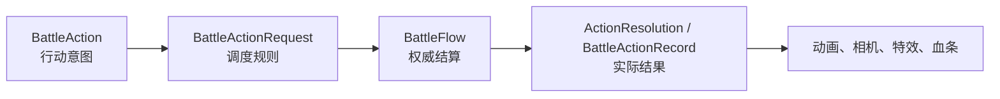
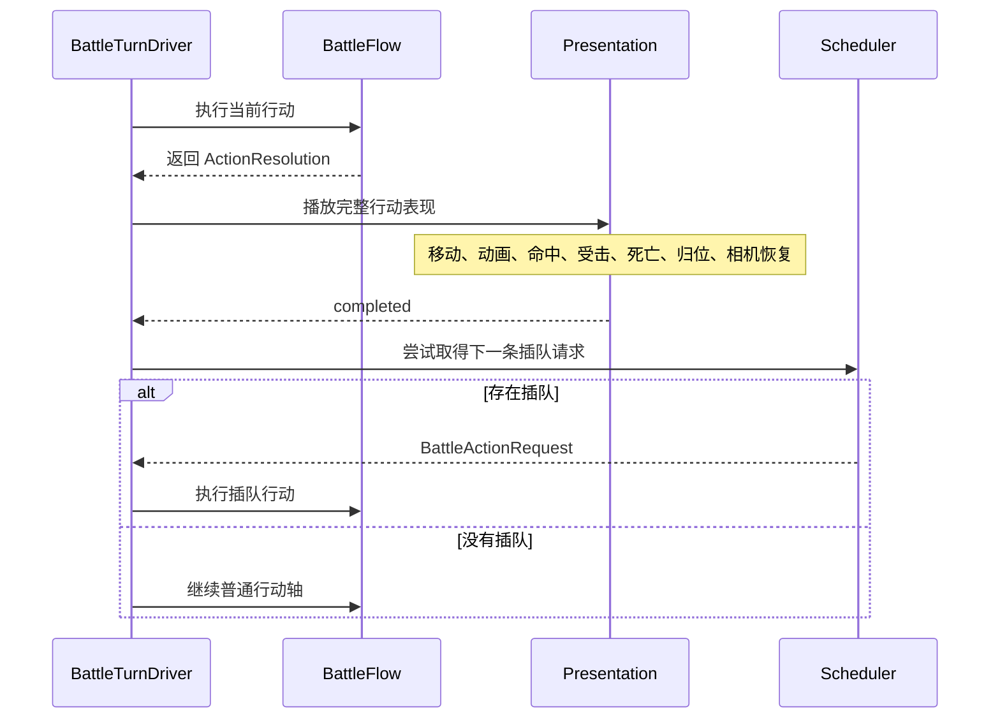

# 从行动条到终结技插队：一套回合制战斗行动调度系统的实现

> 本文记录一套 Unity 回合制战斗系统中“普通行动排队、终结技插队、追加攻击调度”的完整实现思路。重点不是技能数值或动画制作，而是解决三个问题：谁先行动、插队行动如何加入、上一段表现没有结束时为什么不能继续结算。

## 一、为什么不能只用一个行动队列

回合制战斗最初很容易写成下面这样：

```text
找到速度最快的角色
→ 选择技能
→ 结算伤害
→ 播放动画
→ 计算下一个角色
```

如果系统只有普通攻击和战技，这种结构暂时可以工作。但加入终结技、追加攻击、反击以后，问题会立即出现：

- 终结技可以在其他角色的回合中释放，但不应该消耗释放者原本的普通行动；
- 追加攻击由上一行动触发，但应该拥有独立的动画、相机、伤害记录和行动条条目；
- 一个技能的动画尚未结束时，即使新的终结技已经入队，也不能直接切断当前动画；
- 终结技入队时需要锁定能量，否则同一份能量可能被重复预约；
- 插队完成后，原本的普通行动轴必须保持不变。

这说明系统里其实存在两种不同的“队列”：

```text
普通行动轴：由速度和行动值决定谁先行动
插队调度器：由来源、优先级和入队顺序决定谁先插队
```

如果强行把二者塞进同一个列表，就会不断出现特殊判断：终结技是否要重排行动值、追加攻击是否要 Tick Buff、插队后角色的下次行动时间是否需要恢复。最终队列会同时承担时间、资源、优先级和生命周期，越来越难维护。

因此，本系统采用的核心原则是：

> `ActionQueue` 只管理普通行动时间；`BattleActionScheduler` 只管理插队请求；`BattleTurnDriver` 决定两者何时交接。

## 二、先区分三个核心对象

理解整个系统之前，需要先分清三个对象：行动意图、调度请求和结算记录。

### 1. `BattleAction`：角色想做什么

```csharp
public class BattleAction
{
    public BattleUnit caster;
    public SkillConfig skill;
    public BattleUnit mainTarget;
}
```

它只表达三个信息：

```text
谁释放技能
释放哪个技能
主目标是谁
```

例如“角色 A 对敌人 B 使用战技”就是一个 `BattleAction`。

它不关心：

- 这是普通回合还是终结技；
- 优先级是多少；
- 是否消耗普通行动；
- 是否预留了能量；
- 应该何时执行。

所以 `BattleAction` 是纯粹的行动意图，而不是完整的调度单位。

### 2. `BattleActionRequest`：以什么规则执行

插队系统在 `BattleAction` 外面包装了一层 `BattleActionRequest`：

```csharp
public sealed class BattleActionRequest
{
    public long RequestId { get; }
    public long EnqueueSequence { get; }
    public BattleAction Action { get; }
    public BattleActionOrigin Origin { get; }
    public BattleActionExecutionPolicy Policy { get; }
    public int Priority { get; }
    public BattleTargetFallback TargetFallback { get; }
    public int ReservedEnergy { get; }
}
```

它回答的是另一组问题：

```text
这是什么来源的行动？
它的执行优先级是多少？
它是否消耗普通回合？
目标失效后采用什么策略？
它提前预留了多少能量？
```

同一个 `BattleAction` 可以根据不同请求策略表现出不同的生命周期。例如普通行动和终结技都可以释放技能，但二者不应该使用同一套时间规则。

### 3. `BattleActionRecord`：实际上发生了什么

逻辑结算完成后，系统生成 `BattleActionRecord`：

```csharp
public sealed class BattleActionRecord
{
    public long RequestId { get; internal set; }
    public BattleActionOrigin Origin { get; internal set; }
    public int ActionSequence { get; internal set; }
    public int NormalTurnIndex { get; internal set; }
    public bool ConsumedNormalTurn { get; internal set; }

    public BattleUnit Caster { get; internal set; }
    public SkillConfig Skill { get; internal set; }
    public BattleUnit MainTarget { get; internal set; }

    public int EnergyBefore { get; internal set; }
    public int EnergyAfter { get; internal set; }
    public IReadOnlyList<BattleEffectRecord> Effects { get; }
}
```

它是一张不可由表现层重新计算的“结算收据”：

```text
第几个动作
动作来源是什么
是否消耗普通回合
谁释放了什么技能
实际命中了谁
造成了多少伤害、治疗、护盾或能量变化
```

因此完整的数据流是：



这一步分层非常重要：**意图不是调度，调度不是结算，结算也不是画面。**

## 三、普通行动如何排队

普通行动由 `ActionQueue` 管理。系统使用绝对行动时刻，而不是每帧给所有角色减行动值。

基础公式为：

```text
基础行动值 = 10000
下次行动时刻 = 当前战斗时间 + 10000 / 当前速度
```

例如当前战斗时间为 50：

```text
角色 A 速度 100：nextActionTime = 50 + 10000 / 100 = 150
角色 B 速度 200：nextActionTime = 50 + 10000 / 200 = 100
```

因为 B 的绝对行动时刻更小，所以 B 先行动。

核心选择逻辑可以概括为：

```csharp
public BattleUnit PeekNext()
{
    BattleUnit best = null;
    foreach (BattleUnit unit in units)
    {
        if (!unit.IsActive)
            continue;

        if (best == null || unit.nextActionTime < best.nextActionTime)
            best = unit;
        else if (unit.nextActionTime == best.nextActionTime
            && unit.tieBreaker < best.tieBreaker)
            best = unit;
    }
    return best;
}
```

`tieBreaker` 用于解决相同行动时刻的稳定排序，保证相同输入每次得到相同结果。

### 普通行动开始与结束

角色开始行动时，战斗时间推进到它的行动时刻：

```csharp
public void BeginTurn(BattleUnit unit)
{
    CurrentTime = unit.nextActionTime;
}
```

行动结束后，根据结算后的速度重新安排它的下一次行动：

```csharp
public void EndTurn(BattleUnit unit)
{
    int speed = Mathf.Max(1, unit.GetStat(StatType.Speed));
    unit.nextActionTime = CurrentTime + BaseActionValue / speed;
}
```

因此速度 Buff 在本次行动中生效后，会影响角色下一次排队时间。

### 行动提前

行动提前只修改剩余距离，不应该直接把绝对时间乘一个比例：

```text
剩余时间 = nextActionTime - CurrentTime
新行动时刻 = CurrentTime + 剩余时间 × (1 - 提前比例)
```

代码对应为：

```csharp
public void ModifyAction(BattleUnit unit, float ratio)
{
    float remaining = (float)(unit.nextActionTime - CurrentTime);
    unit.nextActionTime = CurrentTime
        + remaining * Mathf.Max(0f, 1f - ratio);
}
```

例如当前时刻为 80，角色行动时刻为 130，剩余行动值是 50。提前 50% 后，剩余距离变为 25，因此新行动时刻是 105，而不是 65。

## 四、为什么插队不修改普通行动轴

假设角色 A 的下次普通行动时刻是 150。此时角色 A 能量已满，在角色 B 的回合中释放终结技。

终结技结束以后，A 的普通行动时刻仍然应该是 150，而不是：

- 重新从当前时间开始计算；
- 被当成已经行动过一次；
- 提前到当前行动者之前；
- 因为终结技而 Tick 一次 Buff。

所以终结技不能通过修改 `ActionQueue` 来实现。它必须进入另一条队列，在执行完毕后再回到原来的普通行动边界。

系统定义了以下行动来源：

```csharp
public enum BattleActionOrigin
{
    NormalTurn,
    Ultimate,
    FollowUp,
    Counter,
    ExtraTurn,
    Scripted
}
```

并将生命周期进一步抽象为三种执行策略：

```csharp
public enum BattleActionExecutionPolicy
{
    NormalTurn,
    FreeAction,
    ExtraTurn
}
```

二者不是重复概念：

- `Origin` 表示行动为什么发生，用于记录、表现和优先级；
- `Policy` 表示行动怎样消耗回合生命周期。

当前规则如下：

| 行动来源 | 执行策略 | 是否推进普通行动轴 | 是否执行回合生命周期 | 是否增加普通回合计数 |
| --- | --- | --- | --- | --- |
| 普通攻击／战技 | `NormalTurn` | 是 | 是 | 是 |
| 终结技 | `FreeAction` | 否 | 否 | 否 |
| 追加攻击 | `FreeAction` | 否 | 否 | 否 |
| 反击 | `FreeAction` | 否 | 否 | 否 |
| 额外回合 | `ExtraTurn` | 否 | 是 | 是 |

目前项目中终结技和 FrostNova 追加攻击已经完整接入。反击、额外回合和剧情行动已经拥有调度语义，但通用触发规则仍是后续扩展内容。

## 五、插队调度器如何工作

`BattleActionScheduler` 内部保存三组状态：

```csharp
private readonly List<BattleActionRequest> pending = new();
private readonly Dictionary<BattleUnit, int> reservedEnergy = new();
public BattleActionRequest ActiveRequest { get; private set; }
```

- `pending`：等待执行的插队请求；
- `reservedEnergy`：已经被终结技预约、但尚未实际扣除的能量；
- `ActiveRequest`：已经取出、正在结算或播放表现的请求。

### 优先级与 FIFO

当前默认优先级为：

```text
终结技    300
反击      200
追加攻击  100
额外回合   50
```

排序规则是先比较优先级，再比较入队序号：

```csharp
pending.Sort((left, right) =>
{
    int priority = right.Priority.CompareTo(left.Priority);
    return priority != 0
        ? priority
        : left.EnqueueSequence.CompareTo(right.EnqueueSequence);
});
```

所以：

- 优先级高的请求先执行；
- 相同优先级按照 FIFO 执行；
- 结果稳定，不依赖对象在内存中的顺序。

### 为什么需要 `ActiveRequest`

取出请求时，调度器不会立刻认为它已经完成：

```csharp
public bool TryTakeNext(out BattleActionRequest request)
{
    if (ActiveRequest != null || pending.Count == 0)
    {
        request = null;
        return false;
    }

    request = pending[0];
    pending.RemoveAt(0);
    ActiveRequest = request;
    return true;
}
```

只要 `ActiveRequest` 存在，就不能继续取下一条请求。

这里的“活动”不仅指逻辑结算，也包括动画、相机、受击、死亡和角色归位。这样可以防止：

```text
技能 A 刚结算伤害
→ 动画 A 仍在播放
→ 调度器立即取出技能 B
→ 相机和角色控制权被技能 B 抢走
```

只有表现层回调完成以后，当前请求才会被清除。

## 六、终结技为什么需要能量预留

终结技可以在另一个技能播放期间入队。如果入队时不锁定资源，就可能出现：

```text
角色拥有 100 能量
→ 终结技 A 入队，但暂时不扣能量
→ 终结技 B 再次检查，仍看到 100 能量
→ 两个终结技都成功入队
```

因此终结技使用两阶段资源处理。

### 第一阶段：入队时预留

```text
实际能量 = 100
终结技消耗 = 100
预留能量 = 100
可用能量 = 实际能量 - 预留能量 = 0
```

角色的实际 `currentEnergy` 此时不变，因此 UI 不会提前表现成已经扣除；但是其他请求已经不能再次使用这份能量。

### 第二阶段：执行时正式消费

请求到达安全执行节点后：

```text
释放预留标记
→ BattleFlow 正式扣除 currentEnergy
→ 发布能量变化事件
→ Ally 能量 UI 更新
```

如果请求在执行前被取消、换波清理、战斗停止或重新校验失败，系统只释放预留，不扣除实际能量。

预留释放采用幂等设计，保证同一请求即使经历异常清理或迟到回调，也不会重复释放并影响其他请求。

## 七、普通行动与插队如何使用同一套结算

普通行动和插队最终都会进入 `BattleFlow.ExecuteRequest()`。差别不在伤害计算，而在执行策略。

核心判断可以概括为：

```csharp
bool normalTurn = request.Policy
    == BattleActionExecutionPolicy.NormalTurn;

bool turnLifecycle = request.Policy
    != BattleActionExecutionPolicy.FreeAction;
```

然后按照策略决定是否执行对应步骤：

```text
如果是 NormalTurn：
    ActionQueue.BeginTurn

如果具有回合生命周期：
    回合开始天赋

所有行动：
    扣资源
    执行技能效果
    生成结构化记录

如果具有回合生命周期：
    Buff Tick

如果是 NormalTurn：
    ActionQueue.EndTurn
    应用行动提前
```

因此系统没有为终结技复制一套伤害结算，也没有为追击单独写一套技能执行器。普通行动和插队共享：

- 技能归属检查；
- 目标选择；
- 战技点和能量处理；
- 伤害、治疗、护盾、Buff 等效果服务；
- 行动记录；
- 表现入口。

它们只在“是否消费普通回合生命周期”上存在差异。

## 八、目标为什么必须在执行时重新校验

插队请求可能等待一段时间。入队时存活的目标，在真正执行前可能已经死亡。

因此系统不能把入队时的目标当成永久有效，而需要在执行前重新校验：

```text
目标仍然属于本场战斗并且合法
→ 保留目标

目标死亡、为空或阵营不匹配
→ 单体／扩散自动选择第一个合法目标

目标来自另一场战斗
→ 直接拒绝，不允许自动替换

AoE
→ 执行时重新读取当前全部合法目标
```

这里需要区分“失效目标”和“外部目标”。前者是正常战斗状态变化，可以回退；后者意味着调用边界错误，必须拒绝。

系统中已经定义 `AutoSelectFirst` 和 `Cancel` 两种目标回退语义。当前实际业务统一使用自动补选，`Cancel` 策略尚未成为正式生产入口。

## 九、安全节点：插队不是随时打断动画

插队系统最容易犯的错误，是把“逻辑上优先执行”理解为“画面上立即硬切”。

当前系统的插队节点位于一整段行动表现结束以后：



`BattleTurnDriver` 是这套安全边界的唯一协调者。它的主要状态包括：

```text
WaitingForPlayer
AutoDeciding
Resolving
Presenting
TransitioningWave
Completed
Faulted
Stopped
```

一次玩家普通行动的流程为：

```text
WaitingForPlayer
→ Submit
→ Resolving
→ BattleFlow.TryExecute
→ Presenting
→ 等待 completed
→ 优先检查插队
→ 没有插队时进入下一普通行动
```

终结技在 `Presenting` 状态期间可以进入 `pending`，但不会立即抢走表现控制权。当前动作完成以后，它才从 `pending` 变成 `ActiveRequest`。

## 十、追加攻击如何成为独立行动

早期实现中，追加攻击很容易直接写在父技能后面：

```csharp
主技能造成伤害();
如果满足条件()
    再造成一次伤害();
```

这种写法虽然数值正确，却会带来严重问题：

- 追加攻击没有独立行动记录；
- 无法单独播放动画和相机；
- 行动条无法显示；
- 表现层不知道第二段伤害来自新的行动；
- 后续很难控制是否再次触发其他反应。

当前 FrostNova 天赋不再直接追加伤害，而是生成新的 `BattleAction`，再转换为 `FollowUp` 请求：

```text
主技能结算
→ AfterAction 检查满足条件
→ 生成 FollowUp BattleAction
→ QueueTriggered
→ Scheduler 入队
→ 当前技能表现完成
→ FollowUp 独立执行
→ 生成独立 ActionRecord
→ 播放独立追加攻击表现
```

为了防止无限递归，追加攻击来源在再次进入天赋判断时会被识别，不能重复触发同一条 FrostNova 追加攻击。

现在“追加攻击”已经不再是父技能里的一个额外伤害数字，而是完整的战斗行动。

## 十一、行动条如何同时显示普通行动和插队

过去行动条若使用下面的结构：

```csharp
Dictionary<BattleUnit, BattleActionTimelineItem>
```

同一个角色只能出现一次。但角色 A 可能同时拥有：

```text
一条原本的普通行动
一条刚刚排入的终结技
```

所以现在行动条使用 `EntryId`：

```csharp
Dictionary<long, BattleActionTimelineItem>
```

普通行动使用稳定的负数 ID，插队行动使用正数 `RequestId`。因此同一角色可以拥有多个不同条目。

行动条快照由 `BattleFlow` 合并：

```text
当前 ActiveRequest
→ pending 插队请求
→ ActionQueue 普通行动快照
```

插队条目会显示来源缩写：

```text
ULT  终结技
FUP  追加攻击
CTR  反击
EXT  额外回合
SYS  剧情／系统行动
```

UI 不需要每帧重算。它只在以下状态节点刷新：

- 请求入队；
- 请求取消；
- 行动开始；
- 进入表现；
- 表现完成；
- 波次切换。

## 十二、停止、取消和换波为什么必须统一清理

插队请求不仅保存一个技能，还可能占用：

- 能量预留；
- `ActiveRequest`；
- 表现控制权；
- 相机和角色显隐状态；
- 等待中的完成回调。

因此停止战斗不能只把 Driver 状态设为 `Stopped`。当前流程会：

```text
增加 Driver generation
→ 标记 stopRequested
→ 清除 pending 请求
→ 清除 ActiveRequest
→ 释放所有能量预留
→ 取消表现队列
```

表现回调会捕获当前 `generation`。如果重试或停止后旧动画才回调，它会因为 generation 不匹配而被忽略，不能重新启动已经结束的战斗流程。

换波也会先清理尚未执行的插队请求。新敌人从当前战斗时间加入普通行动轴，我方原有 `nextActionTime` 保持不变。

## 十三、完整调用链

### 普通攻击／战技

```text
BattleSelectionState
→ BattleManager.SubmitSelection
→ BattleTurnDriver.Submit
→ BattleFlow.TryExecute(BattleAction)
→ 创建即时 NormalTurn Request
→ BattleFlow.ExecuteRequest
→ 逻辑结算并生成 ActionResolution
→ BattleTurnDriver.Present
→ BattlePresentationQueue
→ BattlePresentationCoordinator
→ completed
→ BattleTurnDriver.ContinueUntilPlayer
→ 优先检查插队
→ 继续下一普通行动
```

### 终结技

```text
Ally UI / Ultimate Button
→ BattleManager.QueueUltimate
→ BattleTurnDriver.QueueUltimate
→ BattleFlow.QueueUltimate
→ 校验技能、目标、实际可用能量
→ Scheduler 预留能量并入队
→ 等待当前完整表现结束
→ Driver.TryTakeQueuedAction
→ BattleFlow.TryExecute(BattleActionRequest)
→ 释放预留并正式扣除能量
→ FreeAction 结算，不改变普通行动轴
→ 播放完整终结技表现
→ CompleteRequest
→ 恢复原普通行动流程
```

### 追加攻击

```text
普通技能结算
→ BattleTalentResolver.AfterAction
→ 生成 FollowUp BattleAction
→ BattleFlow.QueueTriggered
→ Scheduler 入队
→ 当前表现完成
→ Driver 执行 FollowUp Request
→ 独立结算、记录和表现
→ 返回普通行动流程
```

## 十四、这套设计解决了什么

最终，这套架构解决了以下问题：

1. 普通行动轴只处理速度和行动时间，不被终结技规则污染。
2. 终结技和追加攻击拥有独立优先级、记录、行动条和表现。
3. 插队行动不会改变角色原本的 `nextActionTime`。
4. FreeAction 不会错误触发 Buff Tick 或消耗普通回合。
5. 能量预留避免同一份资源被重复排队消费。
6. 目标在等待期间失效时会在执行节点重新校验。
7. 插队只在完整表现结束后的安全节点发生，不会破坏动画和相机。
8. 停止、重试和换波可以统一清理请求、资源与迟到回调。
9. 同一角色可以同时出现在普通行动轴和插队行动条中。
10. 新的行动来源可以继续复用同一套技能结算与表现入口。

## 十五、仍然保留的扩展方向

当前项目已经实际完成：

- 普通行动排队；
- 速度与行动提前；
- 我方终结技插队；
- 终结技能量预留；
- FrostNova 独立追加攻击；
- 插队行动的独立记录和行动条；
- 表现安全节点；
- 停止、取消和换波清理。

以下能力已经有调度类型或执行策略，但尚未完成通用业务触发层：

- 受击后反击；
- 通用额外回合；
- 装备、Buff 和关卡机制触发的行动；
- Boss 剧情强制行动；
- `Cancel` 目标回退策略的正式业务入口。

下一阶段不需要推翻当前队列，而应该增加统一的反应上下文，例如：

```text
谁攻击了谁
造成了哪些效果
是否击杀
是否暴击或击破
是否命中指定角色
是否满足某个 Buff 或装备条件
```

触发系统只负责根据上下文生成新的 `BattleActionRequest`，后续排序、结算、表现和清理仍然交给现有系统。

## 结语

回合制战斗中的“插队”并不是简单地把一个角色塞到列表最前面。它至少涉及四种边界：

```text
普通行动时间
插队优先级
资源生命周期
表现完成时机
```

真正稳定的实现方式，是让每一层只负责一件事：

```text
ActionQueue             管普通行动时间
BattleActionScheduler  管插队优先级和资源预留
BattleFlow             管权威规则结算
BattleTurnDriver       管流程和安全节点
Presentation           管动画、相机和画面反馈
```

当这些职责分开以后，终结技、追加攻击和未来的反击就不再是散落在技能代码里的特殊判断，而会成为可以统一排队、统一结算、统一表现的正式战斗行动。
