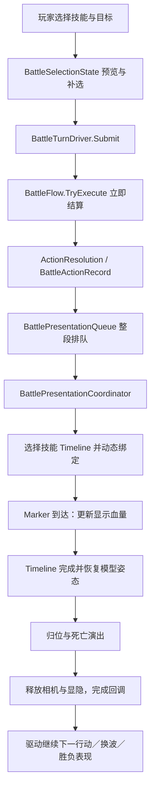

# 战斗技能表现系统方案：现有架构审查与实施设计

日期：2026-11-23  
状态：设计基线。2026-11-24 已实施四模板基础、胶囊示例和配置工具；当前使用说明见 [BattleSkillConfigurationGuide.md](BattleSkillConfigurationGuide.md)，验证与实际边界见 [BattleSkillImplementationReport.md](BattleSkillImplementationReport.md)。下文保留设计时的“拟实施”措辞供对照，不表示所有远期内容已实现。  
补充确认：2026-11-24，近战接近属于技能状态内部的表现，使用 Animator 中独立的接近状态与作者配置的过渡／混合；距离适配只调整接近阶段的整体移动与该状态播放速度。  
依据：当前工作区源码、序列化资源和本次讨论。只读审查未进入 Unity 播放验证；历史验证通过数量不作为本方案已验证的证据。

## 1. 方案结论与已经确定的需求

沿用当前“逻辑先结算，表现按时间展示结果，整次表现结束后继续回合”的基础，补齐四种技能表现模板：

| 模板 | 空间处理 | 作者主要制作的内容 |
| --- | --- | --- |
| 近战接近 MeleeApproach | 真实移动到目标提供的攻击站位点，加技能偏移；结束后返回 | 接近／返回动作、固定攻击距离下的攻击 Timeline |
| 远程 Ranged | 保留当前站位，可有局部踏步或姿态偏移 | 本体动作、发射表现、目标命中表现 |
| 固定演出 Staged | 直接把原表现对象摆到技能规定的位置；结束后恢复 | 固定空间内完整动作、移动、镜头和特效 |
| 我方辅助 Support | 通常保持原站位，全体我方可见 | 施放动作、单体／群体治疗、护盾和增益反馈 |

关键决定：

1. 近战以目标模型上的人工可调攻击站位点为依据，技能再添加局部偏移；不把一个固定距离的整段攻击动画按实际战场距离拉伸。
2. 接近是技能内部的一个表现阶段，使用 Animator 独立接近状态，与攻击／返回状态按作者配置过渡或混合。接近到位后进入攻击阶段；使用攻击 Timeline 的技能在这里启动其局部时间。接近、主演出、返回使用同一个表现时钟，但可以有各自的局部时间。
3. 固定演出使用原角色表现对象，不克隆替身，不重新创建 BattleUnit，不重绑一份战斗身份。
4. “独立场景”首先实现为同一战斗 Unity Scene 中的隔离布景，不要求每次技能都加载／卸载一个 Unity Scene。
5. 逻辑槽位始终不变。移动 PresentationRoot，不移动逻辑身份根，也不修改 BattleUnit.pos。
6. 身体动画控制模型内部；整体位移由唯一持有者控制。第一版禁止 Animator Root Motion 接管整体位移。
7. 对敌方施放技能时，非行动队友在整个行动表现期间保持隐藏；我方辅助技能显示全部我方。固定布景中的非参与者隔离另有独立原因。
8. 需要展示的血条保持可见，并跟随原模型的血条挂点。隐藏操作栏不等于隐藏全部 HUD。
9. 本文确定最终需要的边界，同时分阶段交付。第一阶段先形成一个近战闭环，不先建设完整通用演出平台。

这些决定以用户最新讨论为准，替代此前“所有接近都必须纳入同一条绝对时长 Timeline”和“所有距离统一缩放”的建议。

## 2. 阅读本文时怎样区分现状与设计

- **现有**：从本次读取的源码／磁盘资源直接确认。
- **缺口**：现有实现不足以满足本次目标的地方。
- **拟实施**：本文建议新增或调整的行为，不表示已写入项目。
- 文中的时间、速度、距离均为示例或待调默认值，不是已经测量出的最终手感。
- 现有工作区包含用户的攻击动画、Stone prefab 和 Timeline 修改，以及此前的显隐修改。实施时基于这些改动继续，不回滚、不覆盖作者资产。

## 3. 现有架构实际怎样运行

### 3.1 调用链



现有“等待表现”的入口已经存在，不必修改伤害计算方式来让角色先跑过去。角色跑动期间，权威结果已经生成，但 UI 可以继续显示结算前的血量，直到命中时机。

### 3.2 现有对象职责与本次处理

| 文件／对象 | 当前职责 | 处理建议 |
| --- | --- | --- |
| BattleFlow | 校验、选目标、消耗资源、效果和天赋结算、胜负 | 保留规则；只补必要的结构化记录信息 |
| BattleTurnDriver | Resolving / Presenting 等状态，等待完成回调 | 保留；必要时增加结算前显示快照入口 |
| BattlePresentationQueue | 整段串行播放，generation 与重复完成保护，追加事件屏障 | 保留为整次行动的完成边界 |
| BattlePresentationCoordinator | Timeline、命中显示、舞台、恢复、死亡、相机接管 | 保留总调度，抽出行动会话与角色动作职责 |
| BattleActorRegistry | 单位到原模型的映射、生成和销毁 | 保留；通过它取得角色，不另建战斗单位 |
| BattleUnitActor | PresentationRoot / VisualRoot、血条和相机挂点、包围范围 | 扩充或挂接表现组件，提供攻击站位／命中等挂点 |
| BattlefieldDirector | 原站位、准备前移、归位、有限插值 | 保留槽位与准备行为，增加独占接管，避免与技能移动竞争 |
| BattleShotDirector | 常态构图、选择构图、技能相机令牌、Timeline 相机输出 | 保留；扩充技能阶段和固定空间的参照与返回衔接 |
| BattleDisplayState | 缓存显示血量、死亡可见性、表现时钟 | 扩充必要的显示状态，独立处理临时世界显隐 |
| BattleUIPresenter | 通过 UIManager 打开／刷新三块战斗 UI | 保留 UIManager 所有权，细分演出期间的可见策略 |
| BattlePresentationStudio | 阵型／相机草稿、预览、Scene 手柄、显式保存 | 扩展技能预览；复用草稿与保存习惯，不重写相机工具 |

### 3.3 当前角色层级

BattleActorRegistry.TrySpawn() 创建：

```text
UnitConfig.name [Battle]             身份／生成位置根，位于原逻辑站位
└── PresentationRoot                战斗表现整体位置
    └── 原角色 prefab                BattleUnitActor 通常在这里
        ├── 模型／胶囊／骨骼
        ├── Animator（位置随 prefab 而定）
        └── HealthBarAnchor
```

原身份根保留在槽位上，PresentationRoot 可以离开它。当前模型、Animator 和挂点已经在表现根下，适合直接移动原表现对象。

当前 Timeline 绑定的是 actor.VisualRoot 下的 Animator；当前姿态恢复 CapturePose() 只从 VisualRoot 向下记录局部 Transform，**不会自动保存它上面的 PresentationRoot**。新增整体移动后必须单独保存表现根的位置和朝向。

不要求批量改造所有 prefab。先识别现有 VisualRoot 与 Animator 的实际绑定，在必要的角色上补明确引用，保留已有 AnimationClip 路径。

### 3.4 当前 Timeline 与时钟

BattlePresentationCoordinator 使用 DirectorUpdateMode.Manual：

1. 设置局部 time。
2. Evaluate()。
3. 遍历本帧跨过的 BattleImpactMarker。
4. 通过共享 BattlePresentationClock 推进下一次 time。

相机有专用 BattleCameraShotTrack，混合结果写入 BattleShotDirector。没有技能移动轨道、特效轨道或通用目标反应驱动。

时钟负责暂停、倍速和 SceneFlow 挂起。新增移动、反应、投射物、粒子和等待必须服从该时钟，不能各自用 Time.deltaTime 导致暂停和倍速失配。

### 3.5 当前资源的磁盘事实

本次审查读到：

- `Assets/Animators/Battle/Allies/Capsule_BasicAttack.anim` 已存在。
- Stone prefab 有 Animator，Controller 为空，Apply Root Motion 为 false。
- SampleBattlefield 的 Caster Clip 为 Capsule_BasicAttack，起点 0，时长 0.8 秒。
- Marker 位于 0.45 秒和 0.7 秒，后者 effectIndex = -1。
- Camera 两段仍为 0～0.65 与 0.65～1.2 秒；后一段名为 Impact cut。
- SampleBattlefield 的 Target 轨存在，但磁盘中未看到受击 Clip；当前 enemy prefab 的可见子物体仍名为 enemy。
- 本次文件列表未发现 Capsule_HitLight.anim。

这些是磁盘状态，不能据此否定用户编辑器内尚未保存的工作。实施前先刷新资产并确认作者保存状态；不能自动把用户新动作换回示例。

另外，“相机仍属于整次技能”和“Timeline 内部何时切镜”是两件事。即使整次相机释放正确，0.65 秒内部切镜仍可能早于 0.8 秒动作结束，需要单独预览调整。

### 3.6 当前目标记录需要补充的地方

PreviewAction 会把自动补选后的目标写入预览 Action，正常 UI 提交一般已经带着合法主目标。但 TryExecute 直接记录的是提交请求的 mainTarget，并不保证所有自动／调试调用都已通过预览规范化。

当前协调器从 Effects 中找一个外部受术者作 visualTarget，这只是一种兼容回退：自回能、附带加盾、满血治疗、多效果目标覆盖都可能让“第一条记录的对象”不等于本次主目标。

拟在真正选目标的位置记录主目标组、规范化主目标及各效果实际解析的受术者。主目标若属于已解析主目标组则保留，否则按逻辑实际选择的首个对象确定；不能因为表现需要而另选一次。各效果受术者在该效果执行前记录，遵循当前选择／结算顺序，不把记录目标的改造变成业务规则变更。

## 4. 当前架构必须补齐的缺口

| 缺口 | 为什么影响本方案 | 拟实施的解决方向 |
| --- | --- | --- |
| 没有攻击站位挂点 | 近战无法知道应停在哪里 | 目标 prefab 上配置 MeleeStand；技能附加局部偏移 |
| 没有接近动作 | 现在直接播放攻击 Timeline | 主 Timeline 前增加可变时长 Approach 阶段 |
| 准备移动与技能移动没有所有权隔离 | 两个系统可能同帧写同一 Transform | 每个 actor 单一移动令牌，接管时停止该 actor 的旧准备移动 |
| ReturnHome 用的是准备前移时长 | 多米距离也可能在 0.2 秒返回 | 近战返回独立配置，不能直接沿用 ReadySeconds |
| 只保存 VisualRoot 下的姿态 | PresentationRoot 移出去后可能恢复不全 | 行动会话单独记录根姿态和动画状态 |
| Target 只绑定一个 Animator | 群攻／扩散不能全体受击 | 命中事件向全部对应受术者分发反应 |
| Marker 依赖记录索引 | 群体、多效果和资源记录容易错配 | 增加稳定效果组选择，保留旧索引兼容 |
| 独立舞台克隆原模型 | 不符合直接移动原对象的决定 | 新舞台模式搬动原 PresentationRoot，迁移旧示例 |
| 独立舞台强制隐藏整个 HUD | 会连需要显示的血条一起隐藏 | 操作栏、我方状态、敌方血条分别控制 |
| Renderer 隐藏与血条可见性独立 | 会出现隐藏模型仍有悬空血条 | 世界模型与头顶 UI 共用参与者可见策略 |
| 显示层目前只缓存 HP | 护盾／持续特效无法准确按生效点展示 | 补必要的显示盾量和状态事件，保留权威逻辑不变 |
| FollowUp 不是 Damage 类型 | 当前 HP Apply 与 healthEffectsOnly 不识别它 | 明确追加伤害显示与事件选择规则 |
| 缺少本地动作／反应接口 | 胶囊和人形会分别堆专用代码 | 统一动作请求，驱动器内部选择 Clip／Animator／占位动作 |
| Cancel 是整个战斗表现服务拆除 | 不能当作“跳过一个技能”使用 | 区分单次行动结束与整场 Dispose |
| 缺少完整技能预览 | 目前主要预览阵型和镜头 | 增加四模板预览与攻击点手柄、时间日志 |

## 5. 数据与职责设计

### 5.1 规则配置、表现配置、运行时状态分开

SkillConfig 继续描述伤害、资源、目标侧和规则。不要把 Transform、Animator 或战斗场景引用加进逻辑单位／规则配置。

BattleSequenceDefinition 扩展为技能表现定义，保存：模板、Timeline、近战接近／返回参数、目标挂点偏移、远程／辅助效果、固定演出空间、可见与退出策略。

运行时使用 BattleActionPresentationSession（拟新增普通 C# 类）保存本次结果、参与者、姿态快照、效果消费集合、控制令牌、阶段、临时对象与完成状态。SO 不保存本次目标、当前位置、已触发 Marker 等数据。

表现模板与目标侧分开：Support 通常目标为我方，但敌人也能对敌方队友使用 Support；某个我方技能既伤害敌方又治疗我方时，不能只因选择了近战模板就漏掉队友表现。

### 5.2 技能表现绑定

现有场景映射为 `(skillId, casterFaction) → BattleSequenceDefinition`。先保留旧表作为回退，不要求立刻把所有 UnitConfig 和技能重接一遍。

需要不同角色复用同一 skillId 但演出不同的场景时，增加角色 prefab 表现组件上的技能覆盖表，优先级：

```text
角色自身 skillId 覆盖
→ 现有场景 skillId + faction 映射
→ 明确的安全默认表现
```

覆盖表用稳定 skillId，不依赖运行时克隆 SkillConfig 的对象引用。编辑器检查重复映射并报出来源；不按“普攻／战技／终结技”自动猜测必然属于哪种模板。

### 5.3 角色表现组件

建议在 BattleUnitActor 旁增加一个可选的 BattleActorPresentation 组件（拟新增），集中提供：

- Animator 与默认动作定义。
- MeleeStand 攻击站位点。
- Hit 身体命中点。
- Foot 脚下特效点。
- Cast 发射／施法点。
- LightHit、HeavyHit、Death、Recover 等通用动作配置。
- 必要时的角色技能表现覆盖。

HealthBarAnchor 与 CameraFocusAnchor 沿用 BattleUnitActor。首次接入不批量移动已有子物体，也不为了统一命名破坏 Clip 的相对路径。

没有组件的旧 prefab 使用当前原地兜底，输出可定位的警告。不要因为缺少 MeleeStand 就让角色跑向世界原点。

### 5.4 关键字段草案

以下是配置意图，不是要求第一阶段一次实现全部 Inspector：

| 配置组 | 字段意图 | 用途 |
| --- | --- | --- |
| 基础 | Template、MainTimeline、BindingRoles | 选择模板并绑定角色 |
| 近战 | StandAnchor、StandOffset、FacingOffset | 攻击落脚点与朝向 |
| 接近 | PreferredDuration、MinSpeed、MaxSpeed、Locomotion | 距离与接近节奏 |
| 返回 | ReturnMode、Duration／Speed、ReturnAnimation | 独立控制返程 |
| 本地动作 | AttackLocalPose／LocalMotion | 踏步、后仰等小范围动作，不随战场距离放大 |
| 远程 | CastAnchor、HitAnchor、TravelMode、TravelTime／Speed | 发射与命中对应 |
| 辅助 | RecipientSelector、EffectAnchor、OneShotEffect | 单体／全体生效反馈 |
| 固定演出 | SpaceMode、SceneOrigin／StagePrefab、ParticipantPoses | 原对象临时摆位 |
| 界面 | Commands、PartyHUD、WorldBars、ParticipantVisibility | 分别配置 UI 与模型可见 |
| 结束 | BlockingReactions、ReturnPolicy、DeathExitPolicy、Timeout | 明确完成边界 |

## 6. 挂点与空间约定

### 6.1 攻击站位点与命中点必须分开

```text
侧视示意：

攻击者                  敌人
  O                      O ← Hit，身体命中特效点
 /|\                    /|\
 / \                    / \
  ×----------------------× 地面
MeleeStand               Foot
```

- MeleeStand 表示攻击者站在哪里，通常在目标身体外部的地面。
- Hit 表示武器、射线、特效打在哪里，通常在身体中部。
- 两者都属于目标的外观配置，不参与逻辑命中判定。
- MeleeStand 最好在不随受击弯腰／摇摆的稳定挂点根下；Hit 可以跟随骨骼。
- 攻击站位参考点的位置可手动摆放，朝向约定为“攻击者在该点的默认面向”。

### 6.2 技能偏移的坐标系

近战站位采用目标挂点坐标系：

```text
攻击位置 = 挂点世界位置 + 挂点世界旋转 × 技能位置偏移
攻击朝向 = 挂点世界旋转 × 技能朝向偏移
```

技能偏移使用米制局部单位；只应用挂点的旋转，不让模型缩放额外放大技能偏移。挂点的世界位置本身可以随目标体型改变。

约定界面必须画出前向箭头，避免把“目标自己的朝向”和“攻击者应面向的方向”混为一谈。特殊敌人可配置侧面挂点；第一版先支持一个默认点。

### 6.3 快照时机

在本次行动取得移动控制权、处理完准备前移后，读取起点与目标挂点，生成本次接近终点快照。

默认不因受击动画或骨骼晃动重新计算接近终点。远程默认在发射时记录目标命中点；明确需要跟踪的弹体再选择 FollowTarget。

逻辑已被本次技能打死的目标仍允许取挂点和播放受击／死亡，不能用结算后的 IsActive 过滤它。

### 6.4 位置异常与场地边缘

- 缺挂点：编辑器报出资源问题，运行时使用安全原地表现，禁止跳到零点。
- 终点非有限值、距离超过场地配置上限：拒绝该位移，完成必要显示并恢复。
- 距离接近零：跳过接近，不生成无效 LookRotation。
- 目标在边缘导致终点不合法：允许特殊目标挂点或技能覆盖；第一版不引入 NavMesh 寻路。
- 普通战场应保证直线通路可用；视觉胶囊碰撞体不作为自动寻路依据，不以物理接触决定伤害。

## 7. 模板一：走过去打

### 7.1 完整流程

```text
Prepare
  保存姿态，取得相机和移动控制权，建立显隐范围
Approach
  转向／接近目标攻击站位，播放接近动作
Main
  到位后，攻击 Timeline 从局部 0 秒开始
  Marker 触发已结算结果显示、目标反应和特效
Return
  停止本地攻击位移，执行返回动作与整体返回
Death / Exit
  处理必要死亡段，恢复可见策略、释放相机与控制权
Completed
  只完成一次，回合驱动继续
```

接近属于整次技能的内部状态，不是技能开始前的一次普通走路。Animator 中接近、攻击和可选返回分别配置，状态间的过渡／混合由作者制作。战斗框架负责请求进入接近、调整接近速度，并在到位后发出进入攻击的条件；不能在仍远离攻击点时，仅因接近 Clip 播完就出手。

接近到位与攻击阶段在流程上有先后关系，但身体姿态可以按作者配置平滑混合，不要求硬切。攻击 Clip、命中时序和相机可以继续由现有 Timeline 编排。Animator 过渡与 Timeline 接管需通过动画驱动统一交接，不能假定二者会自动混合，也不能同时无约束地控制同一 Animator。

接近默认使用循环状态，以适应不同路程；非循环的起步／停步动作允许配置为独立过渡。普通配置不需要为不同距离重新制作技能。胶囊缺少接近 Clip 时可临时使用占位表现，不能把这个回退当成最终作者工作流。

### 7.2 接近时间与速度

推荐使用“优先接近时长，速度限幅”的明确规则：

```text
距离 d = 起点到攻击位置的水平距离
期望速度 = d / 期望接近时长
实际速度 = clamp(期望速度, 最低速度, 最高速度)
实际接近时长 = d / 实际速度
```

接近零距离时跳过；期望时长为零只在显式瞬移模式允许，不直接进行除法。

例如期望接近 0.4 秒、速度范围 2～12 米／秒均为调试示例：短距离不会刻意拖长，超长距离允许多跑一会儿。是否使用匀速或缓入缓出由移动配置决定；速度限幅针对峰值也要一致，不能曲线加速后悄悄突破上限。

第一版默认使用匀速接近加短暂转向，先保证上述速度含义清楚。之后增加缓入缓出时，由同一求值器处理峰值限制，不把峰值校验留给作者手算。

接近状态的播放速度通过专属参数调整，例如 `ApproachPlaybackRate`（建议名），不通过整台 Animator 的全局 speed 实现距离适配。若接近 Clip 已标定正常播放时的参考移动速度，可用“实际移动速度／参考移动速度”得到局部倍率，并限制到作者允许范围；若未标定，则由技能配置接近倍率曲线，不能假装可以自动推算准确脚步。

只有接近状态使用这个局部倍率。进入攻击、返回、受击等状态时，不继承接近倍率；攻击不能因为刚才跑得快而挥得快，命中 Marker 也不能随之提前。返回若需要变速，使用自己独立的参数。

全局战斗倍速与接近局部倍率是两种不同含义：暂停／全局倍速统一影响移动和动画一次，接近倍率只额外调节接近动作。由动画驱动组合两者，避免同一全局倍率被重复计算。

当实际移动速度与允许的动作倍率不能兼顾时，优先允许接近时间变化或提供调试警告，不无限加速动作。Animator 参数、过渡时长与混合设置由作者配置并预览，框架不为每个技能硬编码一套过渡。

### 7.3 时间轴为何不会被距离打乱

```text
总行动时间： [接近，长度可变] [攻击 Timeline，内部时序固定] [返回]
攻击局部时间：                  0 ---- 0.45 命中 ---- 结束
```

接近变长只会延后攻击开始，不改变攻击内部 Marker 与挥击动作的对应关系。SampleBattlefield 的 0.45 秒 Marker 仍然是攻击局部 0.45 秒，不需要加上接近秒数修改资产。

需要接近镜头时，给 Approach 单独一段镜头配置或可选短 Timeline，跟随实际接近时长；不要把整个攻击 Timeline 按接近距离变速。

### 7.4 攻击中的小位移

到攻击位置后，现有 Capsule_BasicAttack 的局部前冲继续工作。人形的迈步、前倾等也保留局部尺度。

技能结束清理局部动作后，角色整体仍处于攻击位置，再执行返回。禁止先 Restore PresentationRoot 到原位，再播放返程，否则会出现“瞬移回来后又跑一次”。

### 7.5 返回位置和动作

默认返回该角色的 Home 槽位。行动开始前可能处在 ReadyPosition；这个位置可以作为专用“镜头恢复后后撤”的中间位置，但不能和 Home 混用。

返回支持 ForwardRun、Backstep、AuthoredReturn 和 CutToReadyThenStepBack。第一阶段先做一个默认返回加可选返回 Clip，其他方式在真实技能需要时扩展。

返回位置从槽位服务取得，返回时长独立配置，不沿用 BattlefieldLayout.ReadySeconds。整次返回仍阻塞回合推进。

## 8. 模板二：远程

### 8.1 原地动作与发射

攻击者保持当前表现位置，保存并临时调整面向。身体动作可以包含小幅前移或后仰，结束时恢复。

施放点 Cast 在攻击者身上；命中点 Hit 在目标身上。远程需要知道目标点，不需要借用近战站位点。

### 8.2 两种时间规则

| 模式 | 时间由谁决定 | 结果显示 |
| --- | --- | --- |
| 即时／作者时间 | Timeline 中的 Impact Marker | 到 Marker 展示结果并播放目标反应 |
| 可见飞行弹体 | 发射事件创建弹体，到达事件触发对应效果组 | 到达时展示，等待弹体完成后允许结束 |

普通弹体建议优先固定飞行时间，按距离调整视觉速度，便于与动作和相机对齐；需要固定速度的技能显式选择，并允许整次行动时间变化。

同一个效果组只能被一个触发源消费。弹体到达和 Timeline Marker 不能各扣一次显示血量、各播放一次受击。

主 Timeline 结束但弹体未到达时，等待已登记的阻塞任务，并保持技能相机／合适的等待构图。停止评估主 Timeline 后不能意外回常态镜头。

### 8.3 第一版边界

先支持即时远程，再支持一个目标点的简单弹体。不做抛物线弹道物理碰撞、复杂追踪寻路或弹体决定业务命中。弧线飞行以后是弹体路径的表现参数。

## 9. 模板三：固定演出位置与独立布景

### 9.1 两种空间，共用原对象摆位流程

| 空间 | 实现方式 | 使用场景 |
| --- | --- | --- |
| BattlefieldArea | 战斗场景中指定 StageOrigin，参与者放到技能局部姿态 | 继续使用战场背景的固定构图 |
| IsolatedSet | 实例化只含布景与灯光的 StagePrefab，移动原参与者到挂点并隔离渲染 | 特效较多、背景独立的终结技 |

“独立”主要指视觉环境隔离。第一版不通过 GameSceneManager 切换到新的游戏场景，也不因为播放技能挂起整场战斗生命周期。

舞台位置由显式 StageOrigin 管理，不把固定的世界坐标 `(0,-10000,0)` 当作适用于所有关卡的默认方案。

### 9.2 进入顺序

1. 解析本次参与者：Caster、MainTarget，以及需要显示的其他目标。
2. 为所有参与者取得移动／动画控制权，停止旧插值。
3. 保存 PresentationRoot 世界姿态、模型局部姿态、图层及必要的渲染状态。
4. 准备 StageOrigin、参与者挂点、相机与布景灯光。
5. 在本帧相机输出前，把原 PresentationRoot 放到技能规定的世界位置和朝向。
6. 设置渲染与血条显示范围，绑定 Timeline。
7. 评估第一帧并输出相机，开始演出。

不改变原对象父子层级和所属 Unity Scene；世界坐标移动足以完成摆位，也可减少销毁误归属和恢复父级的风险。

### 9.3 演出中的对象控制

身体动画继续绑定原 Animator。技能需要原样制作整体曲线时，使用“演出位置代理”或专用姿态绑定：

```text
编辑器制作的 Stage 局部位置／旋转曲线
→ 运行时按 StageOrigin 转换到世界姿态
→ 由唯一的技能移动控制者写入原 PresentationRoot
```

代理只是可动画化的姿态参考，不是模型替身，也没有 BattleUnit／血量。不要同时让 AnimationTrack 直接写 PresentationRoot、移动服务又写同一个根。

普通固定演出若双方不需整体曲线，仅设置初始挂点加身体动作即可，不强制添加代理轨道。

### 9.4 渲染与血条

- 隔离布景时，原参与者及技能临时特效进入指定演出图层，退出恢复原图层。
- 保存并恢复每个被改对象的实际 layer，不假定整个人物原来只有一个 layer。
- 相机输出、灯光 cullingMask 和必要的环境设置由会话记录，释放时恢复。
- 头顶血条在屏幕 HUD，继续使用原 actor 挂点与当前输出相机；不能因为输出相机只看演出层就把整个 HUD 关掉。
- 屏幕特效、粒子、Renderer Feature／灯光层并不一定只受 cullingMask 控制；隔离效果需以实际 URP 场景验证，第一版避免修改全局渲染资产。
- 隐藏非参与者时一并处理它们的世界血条、选中圈和临时世界特效，不隐藏固定我方 HUD 卡片。

### 9.5 结束与死亡

第一版默认：在技能结束的切镜边界恢复战场位置，在战场上播放必要死亡／退场段。若以后需要在舞台里完成死亡，增加 DeathInStage 选项；已播放死亡的单位必须登记，回战场后不能再死一次或短暂重新显示。

攻击者可以直接恢复 Home，或恢复 Ready 再后撤，取决于该技能退出配置。恢复期间不能通过宽泛的 activeSelf 快照把已经死亡的单位复活。

### 9.6 现有舞台如何迁移

现有 BattleStage.CloneVisual() 路径与用户决定相反。拟新增原对象舞台执行路径，迁移 SampleSeparateStage，验证完整后移除旧克隆路径。

保留已有 StagePrefab 和 SequenceDefinition 的 GUID。挂点可扩展，但不通过重新创建同名资源替换资产。旧 hideBattleHUD 标志迁移为明确的 UI 策略，迁移报告列出修改对象。

对应的 StageChecks、PlayVerification 中“必须是 clone”“必须隐藏全部 HUD”的断言必须重写，不能为了让旧断言通过保留错误行为。

## 10. 模板四：对我方施加技能

### 10.1 基础流程

```text
原地施放动作
→ 生效事件
→ 对指定队友／全体队友分别播放目标特效
→ 展示治疗／护盾／增益
→ 等待必要动作完成
→ 恢复施放者朝向／局部姿态，结束
```

全体我方模型显示；不因为相机转到某个队友就隐藏其他我方模型。敌方的辅助技能同样可使用这个模板，受术侧按施放者的实际阵营解析。

### 10.2 生效不等于 HP 发生变化

现有 EffectService 在满血治疗且实际恢复为零时，不生成 Heal 记录。如果表现只遍历 Effects，满血队友就不会收到治疗特效。

拟实施：行动记录中增加“主目标组／每个配置效果的已解析受术者”快照，独立于是否产生数值变化。辅助生效事件可以向该组播放特效；结果显示仍只消费实际记录。

这也解决 Self 被当前 `Target != Caster` 过滤、纯资源技能没有外部目标、混合效果需要不同目标组的问题。不能在表现阶段根据结算后存活列表重新选择目标。

“参与表现的目标”和“需要承受伤害的目标”也分开保存。举例，攻击者的回能记录不应让它自己播放受击，附带受益队友也不应被误摆进敌方目标站位。

### 10.3 一次性特效与持续状态特效

一次性恢复光效由本次会话持有，播完可以自然消散，不一定阻塞回合。

护盾罩、持续增益等由“单位状态表现”持有，技能结束不能随会话销毁。生效时登记，状态消失或单位退场时移除。

当前 Buff 记录只用 Name 作为 key、BuffRemoved 只记录数量，尚不足以精确驱动多种持续状态特效。第一版辅助先交付一次性治疗／加盾反馈；持续状态视觉须补稳定 statusId 与移除标识后再做，不能猜名称。

## 11. 命中事件、受击、显示结果

### 11.1 当前索引为何不够

BattleImpactMarker 目前只能选择一个记录索引，或用 -1 消费所有剩余记录。healthEffectsOnly 只过滤 Damage / Heal，不包含 Shield、FollowUp 等。

一个群攻效果会为不同目标生成多条记录；如果第一个 Marker 只消费索引 0，其他目标就会等到兜底标记才掉血。它不能表达“一次挥击同时命中三个敌人”。

### 11.2 拟实施的事件选择

保留旧索引以兼容现有资产，新增按效果组选择：

- 稳定的配置效果序号／可选 authored effectKey。
- 效果来源：主动技能、天赋追加等。
- 受术者组：主目标、该效果全部受术者或指定角色绑定。
- 事件类型：Impact、SupportApply、Launch、CueOnly、FlushRemaining。

效果组来自逻辑结算时的标识，不是表现阶段重新计算伤害。EffectConfig.key 为空或重复时，使用配置序号；不同目标同一效果共享组标识，实际记录序号作为精确去重键。

每条记录最多应用一次；同一个目标在同一个事件中的相同反应最多一次。CueOnly 可用于零伤害、满血治疗或纯特效节奏，不伪造扣血记录。

### 11.3 多段攻击边界

逻辑记录里有多段效果时，分别绑定不同事件。逻辑只有一条总伤害记录时，不能为了视觉三连击就自行重复扣三次。

第一版可前两下仅播放 CueOnly，最后一下显示总伤害。如果以后需要每一下显示分段数值，另行定义显示拆分且总和严格等于原记录；这不是首轮必需能力。

### 11.4 通用受击接口

拟新增角色反应驱动，接收反应种类、来源位置、强度和当前会话标识：

- 胶囊：局部压缩／后仰／回弹或用户制作的 Hit Clip。
- 人形：播放配置的受击 Clip／Animator 状态。
- 大型 Boss：可禁用整体击退，仅局部动作和特效。
- 目标本身有专属 Target 动画轨时，对同一段抑制通用反应，避免两个系统同时写同一 Animator。

Target 动画轨保留给确实需要精确配合的专属演出；普通单体、扩散、群体的轻受击默认走事件分发。

### 11.5 显示血量、护盾与资源

保留 BattleDisplayState.Health 的成功设计，补充下列边界：

1. Damage / Heal / FollowUp 都能正确更新显示 HP。
2. 伤害完全被盾吸收也应有命中反应，不能用 HealthDamage > 0 判断是否打中。
3. AttackResult 有 ShieldDamage，但现有 BattleEffectRecord 没保存伤害前后盾量；需要补充准确字段或关联记录，不能只在命中时读已经结算后的 target.shield。
4. 加盾记录已有 Before / After，可按生效事件更新显示盾量。
5. 技能消耗的战技点／能量默认在确认行动时显示；技能产生的目标恢复在对应生效点显示。第一阶段先保留现有战技点 UI 行为，不顺带重做全资源 HUD。
6. 回合开始天赋、未被记录的能量变化等需要明确最终同步策略，不能声称所有业务状态已经支持逐事件回放。

需要显示盾量和持续状态的阶段，在结算前捕获必要的显示基线。现有 Display 注册时只缓存 HP，无法在结算后补拍正确的“之前盾量”。优先复用显示缓存；必要时让驱动在 TryExecute / TryStep 前提供只读快照入口，覆盖玩家和敌方两条路径，不在 UI 内猜数值。

### 11.6 FlushRemaining 的限制

主 Timeline 中的 -1 只能消费明确属于它的即时剩余组，不能抢先消费已经登记等待弹体到达的组。

最终完成或安全降级前必须把本次尚未展示的结果同步到权威状态，但正常运行中未被事件消费的必要记录要输出资源路径和效果组警告，不能长期用 Flush 掩盖配置错误。

## 12. 动画、移动与时钟的协作

### 12.1 同一对象只有一个位移持有者

角色整体位移的持有者可以是：

- BattlefieldDirector：Home / Ready 转换。
- 本次技能会话：Approach、固定演出、Return。
- 编辑器预览：隔离预览或安全的暂停调参。

拟为 BattlefieldDirector 增加角色级控制令牌：取得时停止该角色旧 motion；持有时拒绝准备前移／ApplyLayout 写入；释放时检查 token，旧会话不能释放新会话。

不使用全场 IsMoving 等待某个角色的接近完成。需要每个角色对应的 motion handle，避免无关单位移动拖住整次行动。

ApplyLayout / 工作台运行时预览在技能 Busy 时拒绝进入，不能为调阵型而把演出中的角色拉回原位。

### 12.2 Animator 与 Timeline

当前代码把绑定 Animator.speed 设为 0，再手动评估 Timeline。这个做法能服务当前占位演示，但不代表已经验证所有 Animator Controller 的接管。

此前 Stone 有 Controller 时不播放、清空后正常的现象，本方案不把原因未经验证地认定为某个 Unity 内部混合规则。拟将其列为独立兼容性测试：

- 占位胶囊：Controller 为空，Timeline 播身体动作，接近／返回可先用程序化动作。
- 配有 Controller 的角色：动画驱动请求进入该技能的接近状态，通过接近状态专属倍率参数适配速度；到位后请求攻击过渡。接近是技能的一部分，不回到普通 Idle 后再重新启动技能。
- 正式人形：同一动画驱动管理接近／返回状态与 Timeline 接管，保存／恢复必要的状态，退出后平滑回 Idle。Controller 内混合与 Timeline 接管的交接要实测；第一阶段先验证基本 Controller 状态和倍率，正式人形阶段再验证完整骨架和过渡质量。
- 同一 Animator 同时绑定两条独立角色轨道（Self 场景）时，校验并合并角色绑定或禁用重复轨，避免重复保存 speed 后恢复成 0。
- Animator 快照按实例去重；先停止 Timeline Graph，再恢复驱动状态，不让 Stop() 的回写覆盖最终恢复。

当前全层级 Transform 快照适合胶囊，但对大骨架每次记录所有骨骼有成本，恢复也可能与 Animator 下一帧竞争。先保留兼容，再以驱动器恢复和必要局部根快照替代，经过正式模型验证后收敛。

### 12.3 同一帧更新顺序

设计目标顺序：

```text
推进共享时钟
→ 更新本阶段整体移动
→ 评估身体动画／Timeline
→ 更新跟随动作的挂点与临时效果
→ 处理跨过的事件
→ 计算并输出技能相机
→ 更新世界血条屏幕位置
```

当前相机 Track 在 Timeline Evaluate 中计算，血条在自己的 LateUpdate 中投影，准备移动也在 LateUpdate。新增跟随镜头后不能假定它们顺序自然正确。需用明确执行顺序或协调器的最终刷新来保证相机读到当帧姿态，血条读到当帧相机。

## 13. 相机、显隐和 UI

### 13.1 相机控制权覆盖完整行动

取得相机令牌应早于接近／临时摆位，释放应晚于必要返回／死亡／退出构图。

阶段建议：Selection → Approach → Main → Return → Death / StageExit → Base。

接近和返回提供简单可配置镜头，不要求作者每个技能都重新制作一整套；主 Timeline 继续使用现有 BattleCameraShotTrack。固定演出增加明确的 Stage 空间参考，不靠移动中的敌我中心猜舞台原点。

### 13.2 模型显隐

普通我方对敌技能：行动者可见，其他我方隐藏到整次行动完成；敌方目标按技能需求显示。

我方辅助：所有我方显示。混合目标技能如果明确需要队友参与表现，可通过该序列的参与者策略覆盖，并在工作台明确显示覆盖，不按附带效果意外改变默认规则。

敌方行动：我方受击者必须可见，不沿用“我方对敌技能隐藏队友”的策略。

固定布景：仅显示参与者的隔离规则可以暂时隐藏双方非参与者；这与普通辅助的“全我方显示”规则分属不同原因，必须显式选择，不能在普通治疗中隐式开启。

现有 Action / Stage 显隐层可保留思路，但最终应统一到会话可见范围，以免相机选择、技能和舞台三方分别恢复 Renderer。不要通过 BattleDisplayState.SetVisible(false) 表示临时遮挡，那个接口目前也承担死亡可见性。

### 13.3 UI 分开控制

| UI | 默认技能期间 |
| --- | --- |
| 指令操作栏 | 禁用输入，可按演出选择淡出 |
| 固定我方状态栏 | 默认保留，不因队友模型临时隐藏而消失 |
| 敌方世界血条 | 对当前允许显示的目标保持跟随，越界时正常隐藏 |
| 选中圈／范围预览 | 确认行动时清理，不带进演出 |
| 伤害数字／目标特效 | 以命中时当帧挂点出现 |

BattleUIPresenter 拟由 SetVisible(bool) 扩展到明确的演出 UI 策略。UI 仍由 UIManager 创建和关闭，不让技能序列重新实例化战斗 HUD。

敌方血条可见性使用：单位仍可显示 AND 本次世界展示策略允许 AND 挂点处于当前相机可见范围。Renderer.enabled 本身不作为唯一判断，因为一个角色可能有多个 Renderer 或暂时全隐的动画段。

## 14. 行动会话与统一清理

### 14.1 会话应保存什么

- 本次唯一 generation／session id、ActionResolution、定义与阶段。
- 参与者绑定，包括施放者、主目标、主目标组、各效果受术者组。
- 原表现根世界位置和朝向、必要局部姿态。
- 原 Animator 关键配置与驱动状态，按实例去重。
- 移动与相机控制令牌。
- 临时 Renderer／layer／灯光／UI 可见范围。
- 已消费记录、已分发反应、已完成死亡，防重复集合。
- 临时特效、弹体、布景与阻塞任务。

不保存一份可回写的战斗 HP／Buff 快照来“恢复战斗”。显示快照只供 UI，不可覆盖业务数据。

### 14.2 四种结束方式

| 结束方式 | 数值显示 | 空间／动画 | 是否继续回合 |
| --- | --- | --- | --- |
| 正常完成 | 按事件消费，最后核对 | 完成配置返回与退出 | 是，一次 |
| 跳过本次表现 | 立即展示本次未完成结果并结束视觉任务 | 快速恢复到规定的安全站位 | 是，一次 |
| 演出错误／超时 | 安全同步已结算结果并记录错误 | 尽力恢复、释放全部控制权 | 安全清理成功后继续；内部状态损坏则 Faulted |
| 整场退出／卸载／重新开始 | 不触发旧完成回调 | 清理，随后由场景／注册表销毁对象 | 否 |

现有 coordinator.Cancel() 会 Dispose Display、清空 flow 与 actors，属于整场退出。拟增加 SkipCurrent / FinishCurrent / AbortCurrent 语义，再保留整场 Dispose。不能用 Cancel() 作为技能跳过按钮。

### 14.3 清理顺序

1. 使旧异步回调失效，禁止弹体到达后再触发过期事件。
2. 停止 Timeline／独立反应的写入，清理临时效果和绑定。
3. 根据退出方式同步必要的显示结果并完成死亡标记。
4. 恢复原图层、渲染和布景环境，恢复存活参与者的空间与动画状态。
5. 清理临时显隐原因，但不复活逻辑／显示上已经死亡的对象。
6. 设置正确的常态相机上下文并完成首帧输出。
7. 释放控制令牌，注销临时任务。
8. 正常／跳过路径完成一次；整场拆除路径不完成旧回调。

清理可重复调用；一个对象已销毁不能阻止其他对象恢复。单项清理异常需要记录并继续释放其余资源。超时按活跃表现时钟计算，暂停时不能被墙钟超时误杀。

## 15. 编辑器与作者实际怎么制作

### 15.1 给敌人配置挂点

1. 打开敌人 prefab。
2. 在稳定的挂点根下创建 MeleeStand，用 Scene 手柄摆在合适的地面位置，前向箭头指向攻击者应面向的方向。
3. 在身体上配置 Hit，在地面配置 Foot，沿用已有 HealthBarAnchor。
4. 选择一名攻击者预览，确认其攻击动画在默认点不会穿模或打空。
5. 保存 prefab，不改变原 GUID。

### 15.2 做一条近战技能

1. 复制／新建表现定义，选择 MeleeApproach。
2. 指定现有攻击 Timeline。
3. 选择攻击者和目标 prefab，查看挂点和最终攻击位置。
4. 调技能站位偏移、接近节奏、返回方式。
5. 在 Timeline 中做攻击动作、命中事件和主镜头；接近距离不写进身体 Clip。
6. 在不同目标槽位和起始距离下预览。
7. 显式保存，进入真实战斗验证。

### 15.3 做固定演出

1. 选择 BattlefieldArea 或 IsolatedSet。
2. 在 StageOrigin 下摆 Caster、MainTarget、其他目标的参考姿态。
3. 用真实外观的预览实例制作动画和镜头；编辑器预览可实例化模型，运行时仍移动原对象。
4. 若有整体曲线，在演出参考姿态上录制，由空间适配层写回原 PresentationRoot。
5. 配命中和退出方式，检查恢复前后的两帧。

### 15.4 工作台需要新增的最小能力

- 技能表现定义选择与来源说明。
- 四模板相关字段，仅显示当前模板必需项。
- 攻击站位点、命中点、最终偏移位置、路径与朝向箭头。
- 起始距离／角色槽位／敌人数／模型选择。
- 分阶段时间显示，区分行动总时间与攻击 Timeline 局部时间。
- 当前根位移持有者、相机持有者、参与者列表。
- 事件日志：组名、目标、消费数量、是否重复／未配置。
- 正常播放、暂停、逐帧、跳过、模拟取消。
- 草稿、Undo、显式保存；运行后可保存作者配置，不能把运行时当前坐标写成技能资产。

现有 Studio 的演出页主要预览相机片段，不是完整技能播放器。拟扩展为技能预览页并保留原功能；技能预览必须与运行时共用空间解析和动作求值。

编辑器任意拖动时间时，重新从初始快照求值，不能累计位移。数值与事件使用假的显示数据，不调用真实 BattleFlow 或玩家存档；回拖不会重复结算，也不残留上次生成的粒子。

## 16. 具体文件改造与新增组件建议

类型名是设计建议，实现时可按当前代码规模合并，不要求为了名称机械拆出大量空类。

| 文件／拟新增类型 | 改造内容 | 原因 |
| --- | --- | --- |
| BattleSequenceDefinition.cs | 模板、接近／返回、挂点偏移、远程／辅助、舞台、UI 与退出配置；新字段私有序列化 | 一条技能的作者配置集中，静态与运行态分开 |
| BattleUnitActor.cs + BattleActorPresentation（新） | 明确根与 Animator 引用、挂点、默认动作与覆盖 | 保留原 actor 与血条，容纳胶囊和人形差异 |
| BattlefieldDirector.cs | Home / Ready 只读查询、角色移动令牌、停止指定 motion | 防止移动争写，避免全场 IsMoving 等待 |
| BattleActorMotion（新，普通类） | 接近／返回求值、朝向、速度和阶段完成 | 与准备前移共享控制边界，使用表现时钟 |
| BattleActionPresentationSession（新，普通类） | 一次行动上下文、快照、记录去重、资源与完成语义 | 总协调器不继续堆所有细节 |
| BattlePresentationCoordinator.cs | 选择模板并推进阶段，统一 session 生命周期 | 继续作为回合驱动对表现的唯一入口 |
| BattleActorAnimationDriver（新） | 接近／返回／受击／死亡动作，Timeline 接管和恢复 | 胶囊和人形对外使用同一请求 |
| BattleImpactMarker.cs | 稳定效果组与 Cue／Launch 事件，兼容索引 | 单体／群体／辅助共用事件分发 |
| BattlePresentationEffects（新） | 一次性特效、简单弹体、任务句柄；状态特效独立持有 | 控制暂停、倍速与生命周期 |
| BattleResolutionRecord.cs + EffectService.cs | 记录已解析目标组、效果序号、必要盾量／状态标识 | 给表现真实证据，不把表现规则放回逻辑 |
| BattleFlow.cs / BattleTurnDriver.cs | 仅在需要时增加结算前基线入口，主目标规范记录 | 覆盖自动补选、满血治疗、敌方自动行动 |
| BattleDisplayState.cs | 追加伤害显示、必要盾量和状态显示 | 避免结算完成但视觉未命中就改变反馈 |
| BattleStage.cs | 布景与多参与者挂点；新路径不 CloneVisual | 实现直接移动原表现对象 |
| BattleShotDirector.cs / 相机 Clip | Stage 空间、阶段镜头、完整生命周期返回 | 保留已有调参成果与所有权机制 |
| BattleUIPresenter.cs / BattleEnemiesStatusPanel.cs | 分层 UI 可见策略、世界血条参与者过滤 | 血条跟着原对象，同时不出现悬空无关血条 |
| BattlePresentationStudio.cs | 技能预览、挂点手柄、阶段日志、显式保存 | 让用户能独立配置与排错 |
| Assets/Editor/*Verification.cs | 扩展真实流程与资源迁移验证 | 验证行为，不只测孤立调用 |

目录沿用 `Battle.Presentation` 与现有 Presentation 目录。新编辑器代码放 `Assets/Editor/`。不批量改命名空间，不借此重构无关 UI／存档／战斗规则。

## 17. 分阶段实施计划

### 阶段一：可交付的近战闭环

交付：

- 攻击站位／命中挂点与技能局部偏移。
- 角色级移动接管，真实接近、到位后攻击 Timeline、独立返回。
- 一个胶囊默认接近／返回表现和用户攻击 Clip 复用。
- 接近作为技能内部 Animator 状态的请求与专属播速参数；验证到位条件驱动退出、过渡／混合可由作者配置，且接近倍率不污染攻击。无接近动画的胶囊提供安全回退。
- 命中时触发单体轻受击，整次表现完成后释放相机和队友隐藏。
- 根姿态／动画状态去重恢复、取消入口与基础调试线。
- 占位旧序列保持原地回退，尚未迁移的技能不自动跑向敌人。

验收：四个我方起点、五个敌方目标位置的组合都能到正确点；不同距离攻击局部 Marker 一致；任意阶段取消不残留；输入和回合在返回前持续阻塞。

### 阶段二：群体事件与原地辅助

交付：

- 已解析目标组、稳定效果组和记录去重。
- 群攻／扩散轻受击分发，不强制每个目标一条 Target 轨。
- Self、单体治疗、全体治疗和加盾的一次性反馈。
- FollowUp 显示缺口修复，必要盾量显示记录。
- 我方辅助全员可见，UI 可见策略拆分，工作台技能预览基础页。

验收：满血治疗也有特效；多个目标同时生效；自己施法不把 Animator speed 恢复为 0；不重复消费记录。

### 阶段三：远程与简单弹体

交付：

- 原地即时远程模板。
- Cast / Hit 挂点，固定时间／固定速度简单弹体。
- 到达命中、阻塞任务、取消／超时和时钟同步。
- 主序列结束后必要等待镜头。

验收：远近目标不打空，暂停弹体停止，倍速正确，不因末尾 Flush 提前掉血。

### 阶段四：固定位置与隔离布景

交付：

- BattlefieldArea / IsolatedSet 两空间。
- 原对象搬入、头顶血条跟随、多参与者站位、图层与灯光恢复。
- 现有 SampleSeparateStage 从克隆路径迁移。
- 固定演出整体姿态代理与完整预览，按实际技能需要提供。
- 退出镜头、死亡与返回策略。

验收：运行时 actor 实例与 Unit 引用均不变；演出位置是技能规定位置；血条从正确输出相机投影；暂停／取消／退出后全部恢复；不复活死者。

### 阶段五：正式人形和制作体验收敛

交付：

- 一名人形的 Idle / Locomotion / Attack / Hit / Death 接入。
- Animator Controller 与 Timeline 的真实接管验证。
- 工作台保存、逐帧预览、诊断和常见错误提示完善。
- 确有需求再增加侧面挂点、特定 Boss 变体、持续状态视觉。

不将根运动适配、抓取双人动作、复杂弹道物理、全场自由寻路列为首轮必要功能。

## 18. 验证设计与完成标准

### 18.1 自动验证矩阵

| 类别 | 必须验证的真实行为 |
| --- | --- |
| 空间 | 挂点旋转与技能偏移；非原点战场；角色／目标缩放；逻辑 pos 与身份根不变 |
| 移动 | 零距离、短／长距离、限速、准备移动接管、返回不瞬移、每个 handle 独立完成 |
| 时间 | 接近长度变化不改变攻击局部命中；暂停、倍速、跨多 Marker 大帧推进 |
| 目标 | 未选／死亡／阵营错误自动补选；记录的实际受术者；本次击杀仍有模型与挂点 |
| 事件 | 单体、多效果、扩散、群体、Self、满血治疗、混合效果、追加伤害、护盾全吸收 |
| 动画 | 无 Controller 胶囊、Controller 接近状态与局部倍率、到位后过渡／混合、攻击不继承接近倍率、有 Controller 人形、目标专属轨与通用反应互斥、共享 Animator 去重 |
| 相机显隐 | 接近至返回全程持有；攻击期间队友隐藏；辅助全员显示；敌方行动显示受击者 |
| UI | 原模型移动时血条跟随；相机输出后投影；隐藏非参与者不留世界血条；固定卡片保持 |
| 舞台 | 原 actor 实例一致、原层级一致、图层／灯光／相机恢复、组目标绑定、死亡不重放 |
| 退出 | 正常、跳过、异常、超时、对象销毁、战斗退出、重试、换波、连续两次会话 |
| 资源 | 旧资产 GUID 不变，旧索引 Marker 可读，新模板未配置时安全回退，生成工具不覆作者资产 |
| 编辑器 | 不运行可预览、反复拖时间不累计、停止还原、Undo、运行后显式保存、不写存档 |

### 18.2 使用现有验证入口

- `Tools > Battle > Verify Action Submission`：规则与记录扩展的回归。
- `Tools > Battle > Presentation > Verify Presentation`：时钟、队列、动作、事件和清理。
- `Tools > Battle > Presentation > Verify Rebuilt System`：现有阵型／选择与配置集成。
- `Tools > Battle > Presentation > Verify Camera Tuning`：调参、显隐与保存回归。
- `Tools > Battle > Presentation > Verify Real Battle Scene`：真实 BattleScene 播放与暂停、返回、舞台。
- 涉及 UIManager / 场景退出时，补对应 SceneFlow 回归。

新增独立动作验证可以整合进上述报告，不为每个字段创建镜像实现的测试。重点是调用真实 Present 与真实场景，不重复此前只测试相机 Acquire 的不足。

### 18.3 实际画面验收

至少保存四段可复核的录屏或连续关键帧：

1. 胶囊从最远槽位接近侧边敌人，命中、受击、返回。
2. 原地远程，弹体发射、到达与血量显示同步。
3. 全体辅助，多个队友同时出现特效，全队可见。
4. 固定演出，原对象摆位、血条跟随、退出恢复；包含一次中途跳过。

只有编译通过不能报告这些画面行为已验证。离线 Roslyn 编译可补充语法检查，但 Unity 内导入、动画绑定、渲染、真实场景验证必须另外运行并记录时间和失败原因。

## 19. 风险、取舍与明确暂缓的内容

| 风险 | 处理原则 |
| --- | --- |
| 走得快但脚步慢 | 限速并有限调整 locomotion 播速，保留延长接近的权利 |
| 攻击点对普通敌人合适，对 Boss 穿模 | 目标自带挂点，技能偏移，必要时 Boss 覆盖，不缩放攻击者 |
| 直线穿过其他敌人 | 先保证阵型通路；必要时手工侧偏或固定演出，不先做自由寻路 |
| 固定摆位被镜头看到瞬移 | 摆位／恢复与切镜在同帧输出前完成，逐帧检查边界 |
| 血条不跟／无关血条悬空 | 移动完整 PresentationRoot，统一世界可见策略与更新顺序 |
| 用户动画路径不一致 | 检查绑定路径，按需适配；不批量重命名敌我子节点 |
| Timeline 末尾清理过早 | 停止 Main 与结束 Action 分开，等待返回和阻塞反应 |
| 状态特效随技能结束被销毁 | 一次性归会话，持续状态归单位状态表现服务 |
| 核心调度器越写越大 | session、motion、animation、effects 按职责抽出，避免四份近似生命周期 |
| 特效无上限等待 | 阻塞与非阻塞明确分类，有活跃时钟超时和取消 |

暂缓：根运动匹配、复杂 IK 接触、双人抓取、大型 Boss 多部位选择逻辑、开放世界追踪寻路、物理弹道决定伤害、终结技业务插队。它们不是四模板闭环的前置条件。

## 20. 本方案最终希望交付给作者的使用方式

**近战：** 给敌人摆好 MeleeStand，给技能调一点偏移，放入攻击 Timeline，选接近与返回动作，系统负责走过去和归位。

**远程：** 做本体动作，选发射挂点与目标命中点，选即时或弹体，系统负责把本次目标绑进去。

**辅助：** 做原地施放动作，给生效事件配目标组和脚下／身体特效，单体、群体和自身共享分发。

**固定演出：** 摆好参与者和镜头，直接做完整技能；运行时把原表现对象搬到这些位置，血条继续跟原单位，结束统一恢复。

作者不需要管理回合状态、重复结算、对象恢复清单、相机令牌或图层回滚。这些由框架承担。作者需要掌握的是挂点、动作、时间轴、镜头与生效标记。

## 附录 A：本次审查的主要源码证据

下列链接均为本项目相对路径，代表本次读过的现有代码，不代表新增方案已实现。

- [BattleFlow](../Assets/Scripts/GamePlay/Battle/InBattle/Common/BattleFlow.cs)：PreviewAction、TryExecute、Act，主目标和效果结算。
- [BattleTurnDriver](../Assets/Scripts/GamePlay/Battle/InBattle/Common/BattleTurnDriver.cs)：Presenting 与继续回调。
- [BattlePresentationQueue](../Assets/Scripts/GamePlay/Battle/InBattle/Common/BattlePresentationQueue.cs)：整段队列、追加屏障和 generation。
- [BattlePresentationCoordinator](../Assets/Scripts/GamePlay/Battle/InBattle/Presentation/BattlePresentationCoordinator.cs)：ActionSequence、PlayTimeline、RestoreSequence、Cancel。
- [BattleActorRegistry](../Assets/Scripts/GamePlay/Battle/InBattle/Common/BattleActorRegistry.cs)：运行时身份根／PresentationRoot 和原 actor。
- [BattleUnitActor](../Assets/Scripts/GamePlay/Battle/InBattle/Common/BattleUnitActor.cs)：VisualRoot、血条／相机挂点和取景范围。
- [BattlefieldDirector](../Assets/Scripts/GamePlay/Battle/InBattle/Presentation/BattlefieldDirector.cs)：Ready / ReturnHome 与 LateUpdate 插值。
- [BattleSequenceDefinition](../Assets/Scripts/GamePlay/Battle/InBattle/Presentation/BattleSequenceDefinition.cs)：当前表现定义和场景技能映射。
- [BattleImpactMarker](../Assets/Scripts/GamePlay/Battle/InBattle/Presentation/BattleImpactMarker.cs)：当前记录索引选择。
- [BattleResolutionRecord](../Assets/Scripts/GamePlay/Battle/InBattle/Data/BattleResolutionRecord.cs)：当前记录字段。
- [EffectService](../Assets/Scripts/GamePlay/Battle/InBattle/Common/EffectService.cs)：实际记录生成、零治疗不记录与效果覆盖目标。
- [AttackService](../Assets/Scripts/GamePlay/Battle/InBattle/Services/AttackService.cs)：ShieldDamage 与 HP Before / After。
- [BattleTalentResolver](../Assets/Scripts/GamePlay/Battle/InBattle/Common/BattleTalentResolver.cs)：FollowUp 记录与未完全记录的天赋状态变化。
- [BattleDisplayState](../Assets/Scripts/GamePlay/Battle/InBattle/Presentation/BattleDisplayState.cs)：当前仅 HP 缓存与死亡可见性。
- [BattleStage](../Assets/Scripts/GamePlay/Battle/InBattle/Presentation/BattleStage.cs)：当前 CloneVisual 与布景校验。
- [BattleShotDirector](../Assets/Scripts/GamePlay/Battle/InBattle/Presentation/BattleShotDirector.cs)：相机令牌、选中显隐、序列参照。
- [BattleCameraShotTrack](../Assets/Scripts/GamePlay/Battle/InBattle/Presentation/BattleCameraShotTrack.cs)：当前相机求值时机。
- [BattleUIPresenter](../Assets/Scripts/GamePlay/Battle/InBattle/Common/BattleUIPresenter.cs)：UIManager 生命周期与当前全 HUD 显隐。
- [BattleEnemiesStatusPanel](../Assets/Scripts/UI/Battle/BattleEnemiesStatusPanel.cs)：LateUpdate 世界血条投影。
- [BattlePresentationStudio](../Assets/Editor/BattlePresentationStudio.cs)：当前预览、草稿、保存、运行时 ApplyLayout。
- [BattlePresentationSetup](../Assets/Editor/BattlePresentationSetup.cs)：现有样例与映射生成，旧资产迁移需兼容。
- [BattlePresentationVerification](../Assets/Editor/BattlePresentationVerification.cs)：当前表现／舞台验证。
- [BattlePresentationPlayVerification](../Assets/Editor/BattlePresentationPlayVerification.cs)：真实场景验证及隔离测试配置。

## 附录 B：本次交付范围

初次方案交付仅新增文档。2026-11-24 按用户确认进入实施，具体改动与验证以实施报告为准；根运动适配、正式人形美术、复杂寻路与持续状态视觉仍按原定边界后续扩展。
