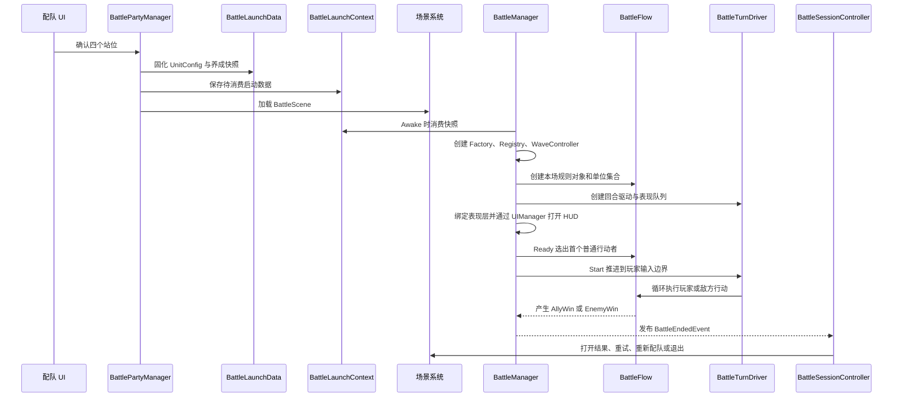
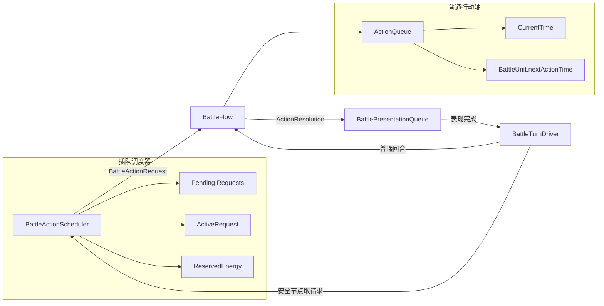
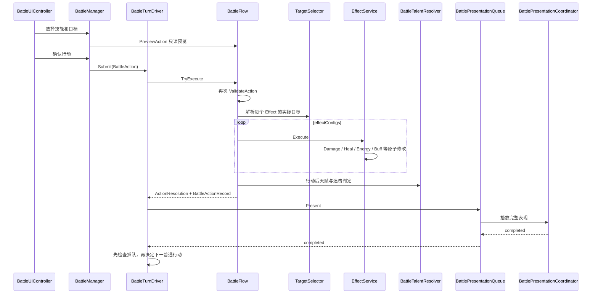
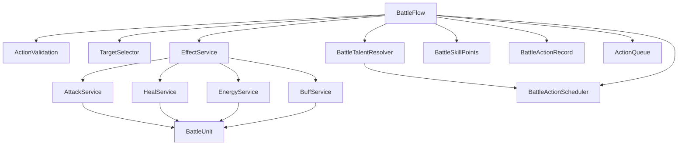
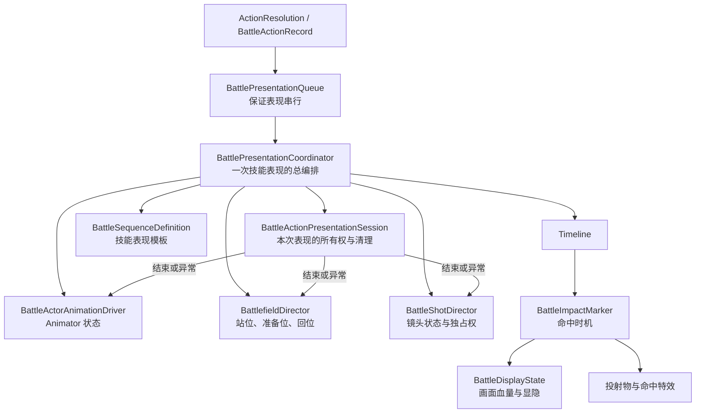
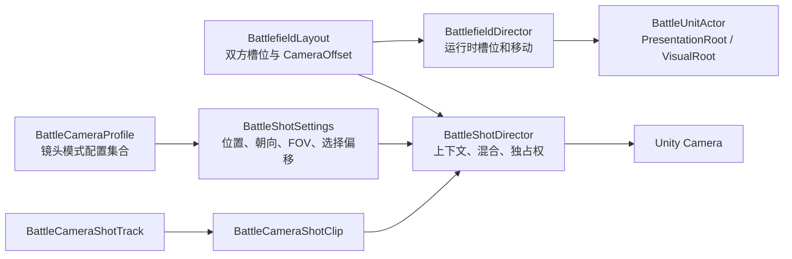
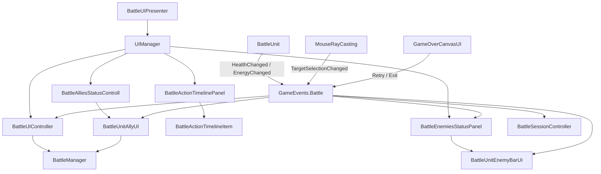
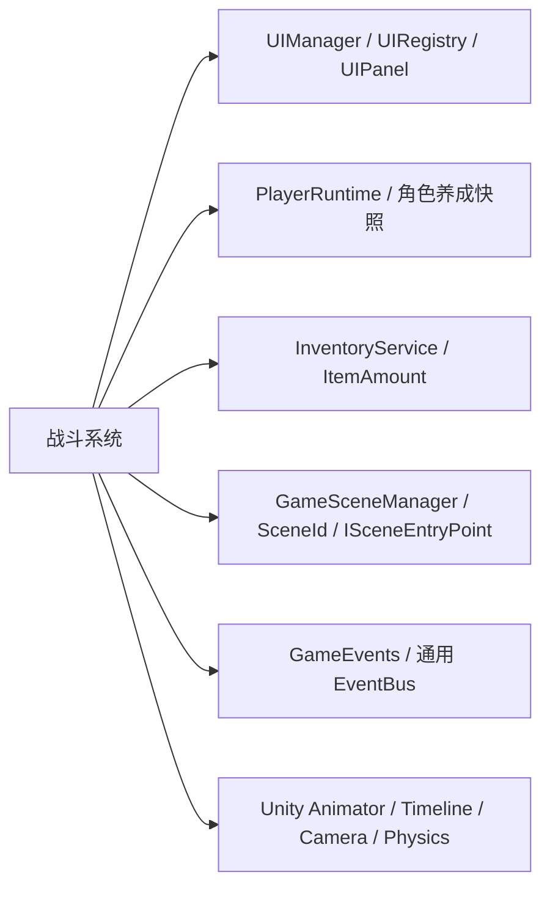

# 当前战斗系统完整框架架构图

> 本文基于当前项目源码整理。统计口径为 `Assets/Scripts/GamePlay/Battle/`、`Assets/Scripts/UI/Battle/`、`Assets/Scripts/UI/BattleParty/`、战斗专用 Editor 工具以及 `FirstSkillDecider`，共 **99 个 C# 文件，约 12,832 行代码**。文末逐一列出全部文件，没有把预留能力写成已经完成的玩法。

## 一、先看整个系统

当前战斗系统不是一个单独的 `BattleManager`，而是由六个层次组成：

```mermaid
flowchart TB
    subgraph OUT[战斗外部]
        PARTY[配队与玩家档案]
        SCENE[场景加载与会话]
        CONFIG[ScriptableObject 静态配置]
    end

    subgraph ENTRY[场景入口与组装层]
        BM[BattleManager<br/>创建和连接本场所有对象]
        SESSION[BattleSessionController<br/>结果、重试、重新配队、退出]
        WAVE[BattleWaveController<br/>波次游标]
        FACTORY[BattleUnitFactory<br/>创建逻辑单位]
        REGISTRY[BattleActorRegistry<br/>逻辑单位与场景模型映射]
    end

    subgraph CONTROL[流程调度层]
        DRIVER[BattleTurnDriver<br/>战斗状态机与安全节点]
        NORMAL[ActionQueue<br/>普通速度行动轴]
        INTERRUPT[BattleActionScheduler<br/>终结技和追击插队]
        SELECT[BattleSelectionState<br/>普通行动选择]
        ISELECT[BattleInterruptSelectionState<br/>插队行动选择]
        AI[EnemyActionDecider<br/>敌方决策]
    end

    subgraph RULE[权威规则层]
        FLOW[BattleFlow<br/>校验、结算、胜负、记录]
        TARGET[TargetSelector<br/>目标规则]
        EFFECT[EffectService<br/>效果分发]
        ATK[AttackService]
        HEAL[HealService]
        ENERGY[EnergyService]
        BUFF[BuffService]
        TALENT[BattleTalentResolver<br/>天赋与追击请求]
    end

    subgraph MODEL[运行时数据层]
        UNIT[BattleUnit]
        ACTION[BattleAction]
        RECORD[BattleActionRecord<br/>BattleEffectRecord]
        SP[BattleSkillPoints]
    end

    subgraph VIEW[表现层]
        PQUEUE[BattlePresentationQueue<br/>顺序播放屏障]
        PCOORD[BattlePresentationCoordinator<br/>动作表现总编排]
        DISPLAY[BattleDisplayState<br/>画面数值状态]
        FIELD[BattlefieldDirector<br/>站位和准备位]
        CAMERA[BattleShotDirector<br/>常态与技能镜头]
        ANIM[BattleActorAnimationDriver<br/>Animator 控制]
        TIMELINE[Timeline 轨道、标记与技能序列]
    end

    subgraph UI[UIManager 管理的战斗 UI]
        UIP[BattleUIPresenter<br/>打开、刷新、关闭 UI]
        COMMAND[BattleUIController<br/>命令输入]
        STATUS[我方与敌方状态栏]
        BAR[BattleActionTimelinePanel<br/>行动条]
        RESULT[GameOverCanvasUI<br/>结果操作]
    end

    PARTY --> SCENE --> BM
    CONFIG --> BM
    BM --> FACTORY --> UNIT
    BM --> REGISTRY
    BM --> WAVE
    BM --> FLOW
    BM --> DRIVER
    BM --> UIP
    BM --> PCOORD
    BM --> SELECT
    BM --> ISELECT
    SESSION <--> SCENE

    DRIVER --> FLOW
    DRIVER --> PQUEUE
    FLOW --> NORMAL
    FLOW --> INTERRUPT
    FLOW --> TARGET
    FLOW --> EFFECT
    FLOW --> TALENT
    EFFECT --> ATK
    EFFECT --> HEAL
    EFFECT --> ENERGY
    EFFECT --> BUFF
    FLOW --> ACTION
    FLOW --> RECORD
    FLOW --> SP
    AI --> FLOW

    PQUEUE --> PCOORD
    PCOORD --> DISPLAY
    PCOORD --> FIELD
    PCOORD --> CAMERA
    PCOORD --> ANIM
    PCOORD --> TIMELINE
    REGISTRY --> PCOORD

    UIP --> COMMAND
    UIP --> STATUS
    UIP --> BAR
    SESSION --> RESULT
    COMMAND --> BM
    STATUS -.事件订阅.-> UNIT
    BAR --> FLOW
```



最重要的依赖方向是：

```text
UI 输入
  -> BattleManager 兼容入口
  -> BattleTurnDriver 流程控制
  -> BattleFlow 权威结算
  -> ActionResolution / BattleActionRecord 结算结果
  -> BattlePresentationQueue 表现屏障
  -> BattlePresentationCoordinator 动画、镜头、特效与画面数值
  -> completed 回调
  -> BattleTurnDriver 检查插队或进入下一普通行动
```

规则层不会等待动画；表现层不能重新计算伤害。二者通过结构化结算记录和完成回调连接。

## 二、系统边界与所有者

| 层次 | 权威状态 | 主要入口 | 不应该负责 |
| --- | --- | --- | --- |
| 配队与启动 | 已确认阵容、本场启动快照 | `BattlePartyManager`、`BattleLaunchData` | 战斗内生命、能量、行动轴 |
| 场景组装 | 本场对象生命周期 | `BattleManager` | 具体伤害公式和镜头轨迹 |
| 流程调度 | 当前处于选择、结算、表现还是换波 | `BattleTurnDriver` | 直接修改生命值 |
| 权威规则 | 单位状态、资源、目标、效果、胜负、记录 | `BattleFlow` | 等待 Timeline 或移动模型 |
| 行动调度 | 普通行动时间与插队请求 | `ActionQueue`、`BattleActionScheduler` | 播放动画和操作 UI |
| 表现 | 显示血量、模型位置、动画、镜头、特效 | `BattlePresentationCoordinator` | 决定真实伤害结果 |
| UI | 显示状态、收集输入、提交请求 | `BattleUIPresenter` 和各面板 | 保存独立的战斗规则状态 |
| 会话与结果 | 战斗结果、奖励、重试、退出 | `BattleSessionController` | 参与单次技能结算 |

## 三、从配队到战斗结束的生命周期



### 初始化时真正创建的对象

`BattleManager.StartBattle()` 是组合根，主要完成以下连接：

```text
BattleLaunchData
  -> BattleUnitFactory
  -> BattleUnit + 运行时技能/Buff 配置

UnitConfig.prefab + 战场站位
  -> BattleActorRegistry
  -> BattleUnitActor

全部 BattleUnit
  -> BattleFlow
     -> ActionQueue
     -> BattleActionScheduler
     -> TargetSelector
     -> EffectService
     -> EnemyActionDecider

BattleFlow + BattlePresentationQueue
  -> BattleTurnDriver

BattleFlow + BattleActorRegistry
  -> BattlePresentationCoordinator

UIManager + BattleFlow + IBattleCommandSource
  -> BattleUIPresenter
  -> 四块战斗 HUD
```

## 四、普通行动与插队行动架构



### 普通行动轴

`ActionQueue` 使用绝对行动时刻：

```text
nextActionTime = CurrentTime + 10000 / speed
```

它只负责：

- 选择下一个普通行动者；
- 推进 `CurrentTime`；
- 行动结束后重新排入角色；
- 根据剩余时间执行行动提前；
- 生成普通行动条快照。

### 插队调度器

`BattleActionScheduler` 只负责：

- 保存终结技、追击、反击、额外回合和脚本请求；
- 根据优先级和入队序号排序；
- 管理 `ActiveRequest`，防止一个表现中途又取出下一个请求；
- 预留终结技能量；
- 在取消、换波或停止时释放预留。

当前默认优先级为：

```text
Ultimate 300 > Counter 200 > FollowUp 100 > ExtraTurn 50
同优先级按 FIFO 执行
```

其中反击、通用额外回合和 `Scripted` 只有调度语义，尚未全部拥有正式业务触发入口。

## 五、一条行动如何完成



### 数据对象的四个阶段

| 阶段 | 数据对象 | 含义 |
| --- | --- | --- |
| 意图 | `BattleAction` | 谁准备使用哪个技能、主目标是谁 |
| 预览 | `BattleActionPreview` + `ActionValidation` | 当前是否合法、预计会影响哪些目标 |
| 调度 | `BattleActionRequest` | 来源、策略、优先级、回退方式和资源预留 |
| 结果 | `ActionResolution` + `BattleActionRecord` | 真正命中的对象与所有效果结果 |

## 六、规则结算内部结构



`EffectService` 是效果类型分发器，真正的原子修改由四个 Service 负责。这样 `BattleFlow` 处理的是“一次行动的生命周期”，Service 处理的是“一次伤害、治疗、能量或 Buff 变化”。

当前已进入规则层的效果包括：

```text
Damage
Heal
AddShield
ApplyBuff
GainEnergy
AdvanceAction
RemoveDeBuff
RemoveBuff
GainSkillPoint
```

弱点、削韧、击破、暴击和持续伤害仍是后续规则，不在当前完成范围内。

## 七、表现层如何消费结算结果



### 为什么存在 `BattleDisplayState`

逻辑伤害在 `BattleFlow` 中已经立即生效，但血条不能在攻击动画开始前先掉血。因此表现层维护一份显示状态：

```text
真实状态：BattleUnit.currentHealth
显示状态：BattleDisplayState 中的可见生命

逻辑结算完成
  -> 真实生命已经改变
  -> Timeline 到达 BattleImpactMarker
  -> BattleDisplayState.Apply
  -> 血条在命中画面上变化
```

这不是重复结算。显示状态只控制画面时机，真实胜负仍由规则层决定。

### 技能表现的五种模板

`BattleSequenceDefinition` 当前支持：

| 模板 | 典型用途 | 空间行为 |
| --- | --- | --- |
| `InPlace` | 原地施法 | 角色留在逻辑站位 |
| `MeleeApproach` | 走过去近战 | 接近目标攻击点，再返回 |
| `Ranged` | 远程攻击 | 本体原地动作，投射物前往目标 |
| `Staged` | 固定区域或独立场景演出 | 临时重排参演者位置 |
| `Support` | 我方辅助 | 对友方目标构图并播放效果 |

无论采用哪种模板，逻辑槽位都不会被表现位移改写。表现结束、跳过、取消或异常时，由 Session 和 Coordinator 统一恢复位置、朝向、层级、显隐、Animator 和镜头所有权。

## 八、镜头与战场站位子系统



职责分界：

- `BattlefieldLayout` 保存可编辑的静态站位配置；
- `BattlefieldDirector` 把槽位转换成运行时世界坐标，并管理准备前移和回位；
- `BattleUnitActor` 把逻辑单位绑定到 `PresentationRoot` 和 `VisualRoot`；
- `BattleCameraProfile` 按镜头模式保存配置；
- `BattleShotDirector` 根据行动者、目标、目标组、Boss 和选中状态解析最终镜头；
- Timeline 中的 `BattleCameraShotTrack` / `Clip` 只用于技能专属时间轨迹镜头；
- `BattlePresentationCoordinator` 在技能期间申请镜头独占权，结束后归还常态镜头。

## 九、UI 与事件连接



`BattleUIPresenter` 不包含战斗规则，它只持有 UIManager 返回的面板句柄，负责：

- 打开我方状态、敌方状态、命令栏和行动条；
- 把 Context 注入各面板；
- 在行动边界刷新；
- 技能演出时隐藏或恢复 HUD；
- 换波时替换敌方状态条；
- 战斗销毁时关闭所有本场 UI。

行动条读取 `IBattleActionOrderSource`，而不是自己推演速度。普通行动用稳定负数 `EntryId`，插队行动用正数 `RequestId`，因此同一角色可以同时显示一个普通行动和一个终结技条目。

## 十、完整源码目录图

下面是本次统计的全部 99 个战斗相关 C# 文件。目录位置本身就是所有权边界。

```text
Assets/
├─ Scripts/GamePlay/Battle/
│  ├─ BattleParty/                                      [4]
│  │  ├─ Common/
│  │  │  └─ BattlePartyManager.cs
│  │  └─ Data/
│  │     ├─ BattleFormation.cs
│  │     ├─ BattleProgressData.cs
│  │     └─ PartyFormationState.cs
│  ├─ Events/                                           [2]
│  │  ├─ BattleEventBus.cs
│  │  └─ BattleResultEvents.cs
│  ├─ Launch/                                           [3]
│  │  ├─ BattleLaunchContext.cs
│  │  ├─ BattleLaunchData.cs
│  │  └─ BattleSession.cs
│  ├─ Register/                                         [1]
│  │  └─ BattleSaveDefinitions.cs
│  └─ InBattle/
│     ├─ Common/                                       [22]
│     │  ├─ ActionQueue.cs
│     │  ├─ BattleActionScheduler.cs
│     │  ├─ BattleActorRegistry.cs
│     │  ├─ BattleDataMaping.cs
│     │  ├─ BattleFlow.cs
│     │  ├─ BattleInterruptSelectionState.cs
│     │  ├─ BattleManager.cs
│     │  ├─ BattlePresentationQueue.cs
│     │  ├─ BattleSelectionState.cs
│     │  ├─ BattleSessionController.cs
│     │  ├─ BattleTalentResolver.cs
│     │  ├─ BattleTurnDriver.cs
│     │  ├─ BattleUIPresenter.cs
│     │  ├─ BattleUnitActor.cs
│     │  ├─ BattleUnitFactory.cs
│     │  ├─ BattleWaveController.cs
│     │  ├─ EffectService.cs
│     │  ├─ EnemyActionDecider.cs
│     │  ├─ FaceCamera.cs
│     │  ├─ IActionDecider.cs
│     │  ├─ MouseRayCasting.cs
│     │  └─ TargetSelector.cs
│     ├─ Data/                                         [15]
│     │  ├─ ActionValidation.cs
│     │  ├─ BattleAction.cs
│     │  ├─ BattleEncounterConfig.cs
│     │  ├─ BattleResolutionRecord.cs
│     │  ├─ BattleSkillPoints.cs
│     │  ├─ BattleUnit.cs
│     │  ├─ BattleWave.cs
│     │  ├─ BuffConfig.cs
│     │  ├─ BuffInstance.cs
│     │  ├─ EffectConfig.cs
│     │  ├─ EnemyWaves.cs
│     │  ├─ Enums.cs
│     │  ├─ SkillConfig.cs
│     │  ├─ UIContextData.cs
│     │  └─ UnitConfig.cs
│     ├─ Services/                                      [4]
│     │  ├─ AttackService.cs
│     │  ├─ BuffService.cs
│     │  ├─ EnergyService.cs
│     │  └─ HealService.cs
│     └─ Presentation/                                 [18]
│        ├─ BattleActionPresentationSession.cs
│        ├─ BattleActorAnimationDriver.cs
│        ├─ BattleActorPresentation.cs
│        ├─ BattleCameraProfile.cs
│        ├─ BattleCameraShotClip.cs
│        ├─ BattleCameraShotTrack.cs
│        ├─ BattleDisplayState.cs
│        ├─ BattlefieldDirector.cs
│        ├─ BattlefieldLayout.cs
│        ├─ BattleImpactMarker.cs
│        ├─ BattlePresentationClock.cs
│        ├─ BattlePresentationCoordinator.cs
│        ├─ BattleSequenceDefinition.cs
│        ├─ BattleShotDirector.cs
│        ├─ BattleShotSettings.cs
│        ├─ BattleStage.cs
│        ├─ BattleStagePoseClip.cs
│        └─ BattleStagePoseTrack.cs
├─ Scripts/UI/Battle/                                  [12]
│  ├─ BattleActionTimelineItem.cs
│  ├─ BattleActionTimelinePanel.cs
│  ├─ BattleActionTimelineUIContext.cs
│  ├─ BattleAlliesStatusControll.cs
│  ├─ BattleCommandsUIContext.cs
│  ├─ BattleEnemiesStatusPanel.cs
│  ├─ BattleResultUIContext.cs
│  ├─ BattleUIController.cs
│  ├─ BattleUnitAllyUI.cs
│  ├─ BattleUnitEnemyBarUI.cs
│  ├─ BattleUnitView.cs
│  └─ GameOverCanvasUI.cs
├─ Scripts/UI/BattleParty/                              [7]
│  ├─ AlliesChooseCanvasUI.cs
│  ├─ AllyView.cs
│  ├─ BattlePartyCanvasUI.cs
│  ├─ PartyEntryButton.cs
│  ├─ PartySceneController.cs
│  ├─ PartySceneNavigator.cs
│  └─ PartyUIContext.cs
├─ Editor/                                             [10]
│  ├─ BattleActionTimelineSetup.cs
│  ├─ BattleActionVerification.cs
│  ├─ BattlePresentationPlayVerification.cs
│  ├─ BattlePresentationSetup.cs
│  ├─ BattlePresentationStudio.cs
│  ├─ BattlePresentationVerification.cs
│  ├─ BattleRebuildVerification.cs
│  ├─ BattleSkillAuthoring.cs
│  ├─ BattleSkillSamples.cs
│  └─ BattleSkillVerification.cs
└─ Scripts/Test/                                        [1]
   └─ FirstSkillDecider.cs
```

## 十一、全部运行时代码职责表

### 11.1 配队、启动、会话与事件：10 个文件

| 文件 | 主要职责 | 关键连接 |
| --- | --- | --- |
| `BattlePartyManager.cs` | 管理已确认阵容，生成战斗启动快照 | `PlayerRuntime`、`BattleLaunchData`、配队 UI |
| `BattleFormation.cs` | 四人阵容及站位的纯数据结构 | `BattlePartyManager`、存档 |
| `BattleProgressData.cs` | 关卡完成记录、奖励回执和战斗进度数据 | `PlayerRuntime`、结果结算 |
| `PartyFormationState.cs` | 无玩家档案时的应用期配队回退缓存 | 配队场景、启动流程 |
| `BattleEventBus.cs` | 定义配队、生命、能量和目标选中事件 | `GameEvents.Battle`、战斗 UI |
| `BattleResultEvents.cs` | 定义结束、重试和退出事件 | `BattleManager`、`BattleSessionController`、结果 UI |
| `BattleLaunchContext.cs` | 跨场景暂存一次待消费启动快照 | 配队场景与战斗场景 |
| `BattleLaunchData.cs` | 固化阵容、配置与角色养成快照 | `BattleUnitFactory` |
| `BattleSession.cs` | 保存战斗场景、退出场景、重试快照和重新配队状态 | `BattleSessionController`、场景导航 |
| `BattleSaveDefinitions.cs` | 向存档系统登记战斗相关定义 | 全局存档框架 |

### 11.2 战斗流程与场景连接：22 个文件

| 文件 | 主要职责 | 关键连接 |
| --- | --- | --- |
| `ActionQueue.cs` | 普通行动绝对时间轴、行动提前、顺序快照 | `BattleFlow`、行动条 |
| `BattleActionScheduler.cs` | 插队优先级、FIFO、ActiveRequest 和能量预留 | `BattleFlow`、`BattleTurnDriver` |
| `BattleActorRegistry.cs` | 创建、查找和销毁逻辑单位对应的场景 Actor | `BattleUnitActor`、表现层 |
| `BattleDataMaping.cs` | 把配置数据映射为运行时单位数据 | `BattleUnitFactory` |
| `BattleFlow.cs` | 权威校验、行动结算、胜负、历史记录和两类队列门面 | 几乎整个规则层的中心 |
| `BattleInterruptSelectionState.cs` | 终结技等插队行动的目标和预览状态 | `BattleManager`、`BattleFlow` |
| `BattleManager.cs` | 战斗场景组合根、兼容命令入口、换波和结果发布 | 所有运行时子系统 |
| `BattlePresentationQueue.cs` | 串行化行动/事件表现并提供完成屏障 | `BattleTurnDriver`、表现协调器 |
| `BattleSelectionState.cs` | 普通技能、目标和只读预览状态 | 命令 UI、相机选择构图 |
| `BattleSessionController.cs` | 监听结果并处理结果页、重试、重新配队和退出 | 事件总线、场景系统 |
| `BattleTalentResolver.cs` | 回合开始/行动后天赋，生成追击等结果 | `BattleFlow`、插队调度器 |
| `BattleTurnDriver.cs` | 玩家/敌方/表现/换波状态机和安全插队节点 | `BattleFlow`、表现队列 |
| `BattleUIPresenter.cs` | 通过 UIManager 打开、刷新和关闭本场 HUD | 四块 HUD 面板 |
| `BattleUnitActor.cs` | 逻辑单位与场景 GameObject、表现根、模型根的绑定点 | Actor Registry、表现层 |
| `BattleUnitFactory.cs` | 从配置与养成快照创建/释放 `BattleUnit` | `BattleLaunchData`、数据映射 |
| `BattleWaveController.cs` | 读取 encounter 波次并维护当前波次游标 | `BattleManager` |
| `EffectService.cs` | 按 `EffectType` 把效果分发给原子 Service | `BattleFlow`、四个 Service |
| `EnemyActionDecider.cs` | 为敌方当前行动者选择技能和目标 | `IActionDecider`、`BattleFlow` |
| `FaceCamera.cs` | 让简单世界对象朝向相机 | 战场辅助显示 |
| `IActionDecider.cs` | 自动行动决策接口 | 敌方 AI、测试决策器 |
| `MouseRayCasting.cs` | 鼠标命中战斗 Actor、维护目标选中并发布事件 | 命令选择、敌方 UI、镜头 |
| `TargetSelector.cs` | 解析 Self、Single、Spread、AoE 的合法目标 | `BattleFlow`、预览与执行 |

### 11.3 数据与静态配置：15 个文件

| 文件 | 主要职责 | 数据性质 |
| --- | --- | --- |
| `ActionValidation.cs` | 行动失败类型、验证结果和提交结果 | 运行时结果对象 |
| `BattleAction.cs` | 施法者、技能和主目标组成的行动意图 | 运行时意图 |
| `BattleEncounterConfig.cs` | 关卡 ID、战技点、波次、奖励和相机配置 | ScriptableObject 静态配置 |
| `BattleResolutionRecord.cs` | 动作、效果和数值变化的结构化结算记录 | 运行时不可逆结果 |
| `BattleSkillPoints.cs` | 我方共享战技点及上下限 | 单场运行时状态 |
| `BattleUnit.cs` | 生命、能量、护盾、速度、Buff、技能和行动时刻 | 单场权威单位状态 |
| `BattleWave.cs` | 单波敌人集合 | 配置数据 |
| `BuffConfig.cs` | Buff 类型、数值、层数和持续配置 | ScriptableObject 静态配置 |
| `BuffInstance.cs` | 某单位身上的 Buff 运行时实例 | 单场运行时状态 |
| `EffectConfig.cs` | 单个技能效果的类型、倍率、目标覆盖和来源 | 技能静态子配置 |
| `EnemyWaves.cs` | 旧/兼容敌人波次容器 | 配置数据 |
| `Enums.cs` | 效果、属性、阵营、目标、技能、属性和命途枚举 | 公共类型定义 |
| `SkillConfig.cs` | 技能类型、消耗、产出、目标规则和效果列表 | ScriptableObject 静态配置 |
| `UIContextData.cs` | 我方和敌方状态面板 Context | UIManager 传参对象 |
| `UnitConfig.cs` | 单位 ID、属性、模型、技能和图标配置 | ScriptableObject 静态配置 |

### 11.4 原子规则服务：4 个文件

| 文件 | 主要职责 | 修改对象 |
| --- | --- | --- |
| `AttackService.cs` | 计算伤害并按护盾、生命顺序应用 | `BattleUnit` |
| `HealService.cs` | 计算并应用治疗 | `BattleUnit` |
| `EnergyService.cs` | 统一增加或扣除能量 | `BattleUnit` |
| `BuffService.cs` | 添加、叠层、移除和 Tick Buff | `BattleUnit.buffs` |

### 11.5 表现、动画、站位和相机：18 个文件

| 文件 | 主要职责 | 关键连接 |
| --- | --- | --- |
| `BattleActionPresentationSession.cs` | 保存本次表现对 Actor、位置、动画、层级和临时对象的所有权并统一清理 | Coordinator、Battlefield、Animation Driver |
| `BattleActorAnimationDriver.cs` | 播放接近、攻击、受击、死亡、返回等 Animator 状态并处理速度 | Animator、Timeline |
| `BattleActorPresentation.cs` | Actor 上的动画、攻击点、特效锚点与技能序列覆盖配置 | Coordinator、技能定义 |
| `BattleCameraProfile.cs` | 一组常态镜头模式配置 | `BattleShotDirector` |
| `BattleCameraShotClip.cs` | 技能 Timeline 中可按空间、曲线、FOV 和震动采样的镜头 Clip | Camera Shot Track、Shot Director |
| `BattleCameraShotTrack.cs` | Timeline 镜头轨道和 Mixer | Shot Clip、Shot Director |
| `BattleDisplayState.cs` | 延迟到命中节点才更新的画面生命与显隐状态 | UI 血条、Impact Marker |
| `BattlefieldDirector.cs` | 解析槽位、准备前移、归位和布局切换 | Battlefield Layout、Actor |
| `BattlefieldLayout.cs` | 双方站位、准备位、CameraOffset 和敌方阵型预设 | ScriptableObject 配置 |
| `BattleImpactMarker.cs` | Timeline 命中、发射、提示和补齐剩余效果的事件标记 | Coordinator、Display State |
| `BattlePresentationClock.cs` | 表现暂停、速度和基于 unscaled time 的 Delta | Coordinator、相机、动画 |
| `BattlePresentationCoordinator.cs` | 编排移动、动画、Timeline、特效、显隐、受击、死亡、相机和清理 | 整个表现层中心 |
| `BattleSequenceDefinition.cs` | 五类技能模板、接近/返回、动画、投射物、独立舞台及超时配置 | Coordinator |
| `BattleShotDirector.cs` | 常态构图、选择目标构图、技能镜头独占、混合和实际 Camera 输出 | Camera Profile、Battlefield |
| `BattleShotSettings.cs` | 单种镜头模式的位置、旋转、FOV、选择偏移和视口锁定参数 | Camera Profile |
| `BattleStage.cs` | 独立演出场景的施法者、目标和额外目标锚点及安全校验 | Staged 技能模板 |
| `BattleStagePoseClip.cs` | Timeline 中驱动独立舞台角色局部姿态的 Clip | Stage Pose Track、Coordinator |
| `BattleStagePoseTrack.cs` | Timeline 独立舞台姿态轨道和 Mixer | Stage Pose Clip |

### 11.6 战斗 UI：12 个文件

| 文件 | 主要职责 | UIManager 角色 |
| --- | --- | --- |
| `BattleActionTimelineItem.cs` | 单个行动条头像、数值、类型和位移动画 | Widget |
| `BattleActionTimelinePanel.cs` | 创建、复用、排序、Hold 和刷新行动条条目 | HUD Panel |
| `BattleActionTimelineUIContext.cs` | 给行动条传入行动顺序源 | Context |
| `BattleAlliesStatusControll.cs` | 创建并刷新我方状态条 | HUD Panel |
| `BattleCommandsUIContext.cs` | 命令源接口和命令面板 Context | Context/边界接口 |
| `BattleEnemiesStatusPanel.cs` | 管理敌方世界状态条、选中和换波条目 | HUD Panel |
| `BattleResultUIContext.cs` | 传递战斗结果、回合和奖励 | Context |
| `BattleUIController.cs` | 普攻、战技、终结技按钮与目标确认输入 | HUD Panel |
| `BattleUnitAllyUI.cs` | 单个我方单位生命、能量、行动状态与终结技按钮 | Widget |
| `BattleUnitEnemyBarUI.cs` | 单个敌方单位生命、选中、行动和世界位置 | Widget |
| `BattleUnitView.cs` | 简单单位状态显示兼容组件 | Widget/兼容层 |
| `GameOverCanvasUI.cs` | 显示胜负、奖励并发布重试或退出请求 | Popup Panel |

### 11.7 配队 UI：7 个文件

| 文件 | 主要职责 | 关键连接 |
| --- | --- | --- |
| `AlliesChooseCanvasUI.cs` | 选择或替换某个站位的角色 | `BattlePartyManager` |
| `AllyView.cs` | 单张角色/站位 UI 的显示和点击 | 配队面板 |
| `BattlePartyCanvasUI.cs` | 显示当前阵容、排序并请求开始战斗 | 配队管理器、场景控制器 |
| `PartyEntryButton.cs` | 从其他界面进入配队场景 | 场景导航 |
| `PartySceneController.cs` | 配队场景入口、创建启动快照并加载战斗 | UIManager、场景系统 |
| `PartySceneNavigator.cs` | 统一返回与场景切换时的上下文恢复 | 场景系统、Launch/Session Context |
| `PartyUIContext.cs` | 配队主面板和选人窗口 Context | UIManager 传参对象 |

## 十二、编辑器工具与验证代码：11 个文件

这些文件只在编辑器或测试中运行，不进入玩家构建的规则核心。

| 文件 | 主要职责 |
| --- | --- |
| `BattleActionTimelineSetup.cs` | 创建缺失的行动条 UIConfig、面板和 Widget 资源 |
| `BattleActionVerification.cs` | 验证行动提交、队列、插队、资源、UI 事件等战斗规则 |
| `BattlePresentationPlayVerification.cs` | 在真实 BattleScene 中做 Play Mode 表现冒烟验证 |
| `BattlePresentationSetup.cs` | 配置 BattleScene、战场、镜头和表现样例 |
| `BattlePresentationStudio.cs` | 可视化调整站位与相机，支持运行时预览和写回配置 |
| `BattlePresentationVerification.cs` | 验证相机调参与表现资源结构 |
| `BattleRebuildVerification.cs` | 验证重建后的表现系统核心约束 |
| `BattleSkillAuthoring.cs` | 技能序列、Actor 表现和 Coordinator 的自定义 Inspector/窗口 |
| `BattleSkillSamples.cs` | 创建五类技能表现模板样例 |
| `BattleSkillVerification.cs` | 验证技能模板、Timeline、标记和绑定配置 |
| `FirstSkillDecider.cs` | 一个只选择首个合法技能的测试 `IActionDecider` |

## 十三、战斗系统依赖但不归战斗模块所有的代码

以下依赖没有计入上述 99 个文件，因为它们属于共享框架或其他业务域：



依赖原则是：

- 战斗通过 `BattleLaunchData` 读取角色养成快照，不在战斗中直接修改养成配置；
- 胜利奖励由 `PlayerRuntime` 和背包系统持久化，`BattleFlow` 不直接写存档；
- UI 由 UIManager 管理生命周期，战斗只提交 Context 和刷新请求；
- 场景切换由统一场景系统完成，战斗模块只维护 Launch/Session Context；
- 事件通过 `GameEvents.Battle` 发布，UI 和会话对象自行订阅并在关闭时释放；
- Unity Timeline、Animator 和 Camera 只属于表现层，不参与规则计算。

## 十四、当前真正的主干与兼容代码

如果只读主干，不需要一开始就读完 99 个文件。当前生产流程的最短主干是：

```text
BattlePartyManager
-> BattleLaunchData
-> BattleLaunchContext
-> BattleManager
-> BattleUnitFactory / BattleActorRegistry / BattleWaveController
-> BattleFlow
-> ActionQueue + BattleActionScheduler
-> BattleTurnDriver
-> BattlePresentationQueue
-> BattlePresentationCoordinator
-> BattleUIPresenter
-> BattleSessionController
```

以下文件更偏兼容或辅助，不是理解主流程的第一优先级：

- `EnemyWaves.cs`：旧/简单波次数据容器；
- `BattleDataMaping.cs`：配置到运行时对象的映射辅助；
- `FaceCamera.cs`：简单朝向相机组件；
- `BattleUnitView.cs`：较简单的单位 UI 兼容组件；
- `BattleSaveDefinitions.cs`：存档登记入口；
- `FirstSkillDecider.cs`：测试决策器。

它们仍然属于当前代码库，所以保留在完整清单中，但不应把它们误认为新的架构中心。

## 十五、推荐阅读顺序

### 第一轮：先建立数据流

```text
BattleAction.cs
-> ActionValidation.cs
-> BattleResolutionRecord.cs
-> BattleUnit.cs
-> SkillConfig.cs
-> EffectConfig.cs
```

目标：理解“意图、验证、真实状态、配置、结算结果”不是同一种数据。

### 第二轮：读规则结算

```text
ActionQueue.cs
-> BattleActionScheduler.cs
-> TargetSelector.cs
-> EffectService.cs
-> 四个原子 Service
-> BattleTalentResolver.cs
-> BattleFlow.cs
```

目标：理解普通行动、插队、目标解析、效果执行和追击生成。

### 第三轮：读流程控制

```text
BattleTurnDriver.cs
-> BattlePresentationQueue.cs
-> BattleManager.cs
-> BattleWaveController.cs
-> BattleSessionController.cs
```

目标：理解什么时候能输入、什么时候等待表现、什么时候插队、换波和结束。

### 第四轮：读表现系统

```text
BattleUnitActor.cs
-> BattleActorRegistry.cs
-> BattlefieldLayout.cs
-> BattlefieldDirector.cs
-> BattleSequenceDefinition.cs
-> BattleActionPresentationSession.cs
-> BattleActorAnimationDriver.cs
-> BattleShotDirector.cs
-> BattlePresentationCoordinator.cs
```

目标：理解逻辑槽位为什么不受模型移动影响，以及动画、镜头和命中时机如何协作。

### 第五轮：读 UI 和场景闭环

```text
BattleUIPresenter.cs
-> UIContextData.cs / BattleCommandsUIContext.cs
-> BattleUIController.cs
-> 状态栏与行动条
-> BattleEventBus.cs
-> BattleResultEvents.cs
-> BattleSessionController.cs
```

目标：理解 UI 只提交请求和显示结果，以及订阅如何在生命周期结束时释放。

## 十六、用一句话概括当前架构

当前战斗框架是一套以 `BattleManager` 为场景组合根、以 `BattleFlow` 为规则权威、以 `BattleTurnDriver` 为流程状态机、以普通行动轴和插队调度器为双队列、以结构化结算记录连接表现层、再由 UIManager 和事件总线连接界面的分层战斗系统。

它的核心边界可以压缩成下面五行：

```text
BattleManager             组装本场战斗
BattleTurnDriver          决定现在该输入、结算、表现、插队还是换波
BattleFlow                决定行动是否合法以及真实结果是什么
BattlePresentation        决定结果什么时候、以什么动画和镜头显示
BattleUIPresenter / UI     显示状态并把玩家意图提交回系统
```
