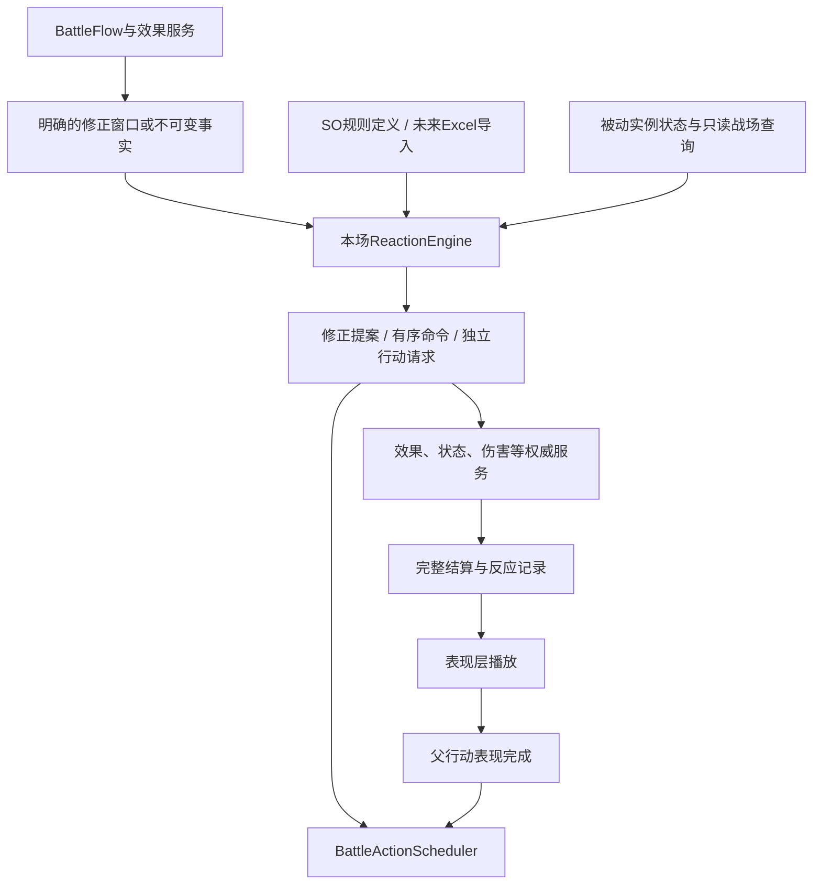

# 可组合天赋系统：研究与后续设计

记录日期：2026-11-27。

**状态：设计备忘，尚未实施。用户决定先保存，后续再开发。** 本文整理本次讨论和已读取的网络资料，不表示这些能力已存在于项目中，也不构成已完成所有时序决策的实施规格。

## 1. 已确定的目标和范围

- 将天赋从角色枚举和集中式 `switch` 中解耦。新增普通天赋应通过规则组合实现；新增底层能力通过独立扩展模块接入。
- 首先覆盖角色与敌人天赋；装备、Buff、场地等保留共同接入协议，本阶段不要求迁移所有相关业务。
- 采用“可配置规则组合 + C# 基础能力/特殊扩展”。不要求每个天赋写一个专属类，也不承诺任意新玩法完全不写代码。
- 配置先可使用 SO，未来通过 Excel 转 SO。配置采用稳定 ID、明确类型和资源引用，不依赖可视化节点编辑器。
- 计数、冷却、次数、标记等状态属于每场战斗的运行时实例，不能写回 SO 或角色永久存档。
- **独立追击、反击等行动等父技能整次表现结束后执行。** 技能过程中可以收集触发和预约请求；减伤、保命等规则仍须在对应逻辑节点即时生效。
- 本文研究同类效果的可复用结构，不追求复刻星铁内部源码或所有隐含时序。

## 2. 现有架构与改造边界

本次阅读过的主要项目入口：

- `Assets/Scripts/GamePlay/Battle/InBattle/Common/BattleTalentResolver.cs`
- `Assets/Scripts/GamePlay/Battle/InBattle/Common/BattleFlow.cs`
- `EffectService`、`AttackService`、`BuffService`、`BattleActionScheduler`、`BattleTurnDriver`。
- `BattleActionRecord`、`BattleEffectRecord`、`BattleCharacterSnapshot`、`CharacterGrowthConfig`。

当前天赋主要通过 `OnTurnStart` 和 `AfterAction` 处理，读取行动摘要中的受伤目标、治疗目标、击杀和负面效果标记。部分天赋直接修改护盾、Buff、能量或行动轴；FrostNova 返回独立追击请求。当前触发行动还依赖角色单一 `talentAction`，需要后续扩展。

主要限制：

1. 集中判断当前施放者的天赋，难以表达队友受击、敌人离场、任意单位施加状态等观察关系。
2. 触发条件、目标选择、状态管理、效果修改和临时配置创建混在一个类中。
3. 只有行动级摘要，无法精确区分多段攻击、护盾吸收、主动扣血、实际治疗和致命伤。
4. 部分天赋绕过统一效果记录，表现、日志和回溯无法完整解释变化来源。
5. 缺少按天赋实例持有的次数、冷却、专属资源及标记状态。

继续保留现有职责：`BattleFlow` 组织权威结算，效果服务修改战斗数据，`ActionResolution` 汇总行动，记录对象交给表现层，`BattleActionScheduler` 调度独立行动，`BattleTurnDriver` 等待表现完成。

新系统应扩展这些边界，而不是让天赋直接操作 Animator、相机、UI 或通过全局 UI 通知驱动业务。

## 3. 网络样本与证据边界

资料来源为本次实际读取的 BWIKI 中文角色页面，属于社区维护资料。Honey Hunter 请求超时，Prydwen 被访问验证拦截，不作为已核实来源。以下内容是机制概括，不是完整面板文本或官方实现说明。

部分页面同时收录不同版本/强化版本：刃、卡芙卡、黑天鹅等必须分版本理解，不能拼接规则。页面描述未明确的多段触发、阈值重复触发和同优先级顺序仍需查证或由本项目自行定义。

| 样本与来源 | 读取到的代表机制 | 揉开后的通用能力 |
| --- | --- | --- |
| [克拉拉](https://wiki.biligame.com/sr/克拉拉) | 常驻减伤、受攻击后标记攻击者并反击；终结技另行强化反击 | 常驻修正、事件来源目标、标记、主动技能修改被动规则 |
| [三月七·存护](https://wiki.biligame.com/sr/三月七) | 持盾友方受攻击后对攻击者反击，有每回合次数 | 跨角色观察、护盾快照、反击额度、来源目标选择 |
| [姬子](https://wiki.biligame.com/sr/姬子) | 开场充能、击破充能、我方攻击后满充能追击并消耗 | 多节点共享资源、触发阈值与执行节点分离 |
| [刃](https://wiki.biligame.com/sr/刃) | 受伤或耗血积累充能、一次受攻击最多一层、满层追击并治疗 | 生命变化原因、攻击粒度去重、复合效果、消耗时机 |
| [砂金](https://wiki.biligame.com/sr/砂金) | 持特定盾友方受击获得盲注、7点消耗发动追击、最多10点 | 特定状态识别、阈值与容量分离、定量消耗、冷却 |
| [真理医生](https://wiki.biligame.com/sr/真理医生) | 战技追击概率随负面状态数量提高，原目标死亡后随机替补 | 数值表达式、概率类型、目标失效策略 |
| [希儿](https://wiki.biligame.com/sr/希儿) | 特定攻击击杀后额外行动与增幅，该天赋额外行动不再次触发自身 | 来源链、额外行动策略、选择性禁止循环 |
| [黑塔](https://wiki.biligame.com/sr/黑塔) | 我方攻击使敌人生命达到特定阈值后追击 | 前后快照、阈值条件、逐目标触发状态 |
| [罗刹](https://wiki.biligame.com/sr/罗刹) | 消耗白花展开结界，友方攻击后回血，拥有者无法战斗时解除 | 持续规则、攻击者与治疗属性来源分离、拥有者生命周期 |
| [符玄](https://wiki.biligame.com/sr/符玄) | 可战斗时全队减伤、有限次数低生命回复、致命攻击不可触发该回复 | 光环、条件回复、已损失生命取值、致命伤排除 |
| [杰帕德](https://wiki.biligame.com/sr/杰帕德) | 致命攻击时避免无法战斗并回血，单场一次 | 死亡确认前干预、战斗级使用额度 |
| [白露](https://wiki.biligame.com/sr/白露) | 生息受击治疗有次数；队友致命攻击救援有战斗次数 | 按受益目标与按拥有者分别保存额度、救援窗口 |
| [黄泉](https://wiki.biligame.com/sr/黄泉) | 任意单位施加负面效果时获得专属资源、同技能一次、敌方标记离场转移 | 行动级聚合、专属资源、逐目标状态、排序与转移 |
| [卡芙卡](https://wiki.biligame.com/sr/卡芙卡) | 页面不同版本包含队友普攻/攻击触发，以及次数重置/额度恢复 | 攻击标签过滤、不同的额度恢复政策 |
| [黑天鹅](https://wiki.biligame.com/sr/黑天鹅) | 持续伤害、奥迹层数、自然结算附加效果；版本间有重置/减半差异 | 持续伤害与攻击区分、状态结算原因、层数策略 |
| [景元](https://wiki.biligame.com/sr/景元) | 神君拥有速度、段数、行动以及与角色的控制/生存联动 | 独立行动实体、所有权关系、召唤生命周期 |
| [飞霄](https://wiki.biligame.com/sr/飞霄) | 我方每两次攻击产资源，排除自身终结技；队友攻击触发限次追击 | 攻击计数与伤害段分离、来源过滤、拥有者回合重置 |
| [貊泽](https://wiki.biligame.com/sr/貊泽) | 猎物存在时离场，队友攻击猎物产生附加伤害并耗充能，每耗3点追击 | 生存/可选中/行动资格分离、标记绑定、累计消耗、附加伤害标签 |
| [翡翠](https://wiki.biligame.com/sr/翡翠) | 自身或收债人攻击按命中敌人数充能，8点追击，自己的该追击不产充能 | 绑定角色、目标去重聚合、资源消费、自身反应过滤 |
| [知更鸟](https://wiki.biligame.com/sr/知更鸟) | 全队暴伤增益及我方攻击后自身回能 | 常驻修正与事件反应并存 |
| [云璃](https://wiki.biligame.com/sr/云璃) | 受攻击后回能及扩散反击，无可反击目标时随机替补 | 多效果组合、攻击来源及邻接目标、失效回退 |
| [阿格莱雅](https://wiki.biligame.com/sr/阿格莱雅) | 忆灵独立属性、最新目标独占标记、附加伤害，忆灵另有召唤/消失规则 | 主从实体、派生属性、独占标记、生命周期反应 |

必须区分基础天赋、战技、终结技、额外能力和星魂。例如罗刹自动治疗还涉及战技，符玄分摊伤害属于战技，克拉拉强化反击属于终结技联动。

## 4. 底层组合模型

一个天赋是一个规则包，可以拥有多条共享状态的规则、常驻修正和可引用技能。推荐概念结构如下，类型名称暂定：

```text
PassiveDefinition
  身份：稳定ID、名称、描述、版本
  参数：数值、公式、技能/Buff引用
  状态声明：充能、额度、计数、标记、绑定对象
  规则列表
    触发节点
    观察范围与事件过滤
    条件组合
    聚合和去重范围
    次数/冷却/概率
    目标查询
    有序操作列表
  常驻修正与生命周期约束
```

### 4.1 战斗事实、修正窗口与表现节点分开

已经发生的事实，如伤害落地、状态成功施加、攻击完成，应是不可变记录。

尚未提交的伤害、治疗和死亡确认属于受控修正窗口，允许提交修正提案，但不能伪装成已经完成的事实。原讨论中的 `BeforeDeath` 仅代表死亡确认前干预，不能先发布正式死亡、胜负结果再回滚。

表现命中标记用于展示已结算结果，不能反过来发出一遍权威伤害或天赋触发。

候选节点族包括：战斗/波次/实体加入与离场、回合边界、行动提交与结束、攻击结束、伤害/治疗/资源提交前后、状态添加/刷新/移除/过期、致命伤处理和专属资源变化。只在底层真正拥有这些语义后发布对应节点，不先堆一批没有准确含义的事件名。

### 4.2 精确区分行动、攻击、伤害和原因

一次行动可能包含多次攻击；一次攻击可能命中多目标、多段伤害。攻击不是 Timeline 的视觉命中次数，也不等于 `EffectConfig` 数量。

需要独立的行动ID、攻击组ID、效果/事实ID和来源链。新增内容能够声明攻击分组；旧内容可用明确的兼容映射，具体映射实施前确定。

伤害元数据应区分普通攻击、战技、终结技、追击、反击、附加伤害、持续伤害等标签。反击可同时属于追击，不宜只靠互斥枚举表达。主动消耗生命、转移伤害、护盾吸收、生命伤害也须区分。

貊泽附加伤害不视为一次攻击，因此不能使“我方每两次攻击”的计数额外增长。翡翠按一次攻击命中的不同敌人数计数，而不是按伤害条数计数。

### 4.3 上下文与只读查询

规则上下文分别提供拥有者、事件来源、事件目标、行动者、主目标、影响目标集合、召唤者，以及变化前后快照、行动标签、来源规则和链路信息。

规则通过受限制的只读查询访问战场，不把完整可变 `BattleFlow`、列表和单位修改权限暴露给条件处理器。`Validate`、预览和条件判断不消耗额度、不修改状态、不抽取权威随机数。

### 4.4 条件、数值和目标查询

条件支持 All/Any/Not、单位关系、存活与资格、技能/伤害标签、状态及层数、资源阈值、数值变化和次数检查。

数值表达式支持常量、拥有者/来源/目标属性、最大/当前/已损失生命、层数、目标数量，以及受约束的加减乘除、上下限。采用类型明确的操作符，不直接执行表格中的任意代码字符串。

目标查询支持拥有者、攻击者、受击者、绑定单位、原主目标、影响集合、同阵营/敌阵营、邻接、按生命比例或层数排序、随机筛选。随机数由本场受控随机源提供，便于复现。

随机目标、概率判定和目标失效回退分别配置。概率还需要区分固定概率与受命中/抵抗影响的基础概率；未实现后者公式时不能把两者当成相同功能。

### 4.5 每个来源实例的运行时状态

运行状态按“本场战斗 + 拥有者 + 被动来源实例”隔离，同一个 SO 被多个单位使用时不得共享计数。

通用状态包含计数器、可消耗资源、可恢复额度、冷却、布尔状态、绑定单位和逐目标标记。阈值、容量、消耗量、溢出、重置或恢复节点分别声明。

明确区分一次攻击、一次行动、拥有者回合、目标回合、波次和整场战斗。不能用全局 `TurnCount` 同时代表这些周期。

状态操作应受引擎控制并产生日志。独立行动还需处理已预约资源与实际消耗，避免同一满层状态在排队等待期间重复触发；失败、取消时是否退还须有明确政策。

### 4.6 三类输出与扩展服务

| 输出 | 用途 | 执行方 |
| --- | --- | --- |
| 效果/状态命令 | 治疗、护盾、能量、Buff、标记、计数、行动提前 | 统一效果和状态服务 |
| 修正提案 | 减伤、伤害加成、免疫、治疗修正、死亡确认前保护 | 对应结算管线 |
| 独立行动请求 | 追击、反击、额外行动、自动施法 | 调度器及Driver |

常驻光环或条件属性贡献通过修正提供者表达，需要明确注册、刷新和撤销，避免每次收到事件就重复加基础属性。

召唤、领域和行动资格变更属于专门基础模块；天赋引用其能力，不能把这些全部塞进一个反应执行器。独立行动实体不必都伪装成有普通血量的角色；神君与可受击忆灵应由实体模块区分能力。

## 5. 建议的系统职责



- `ReactionEngine` 是每场战斗独立的规则分派器，按触发节点索引规则；它不依赖全局UI事件订阅顺序。
- 旧讨论中的 `BattleFactBus` 若保留该名字，只表示本场受控事实队列，不是允许任意订阅者立即修改数据的广播总线。
- 条件、数值、目标、命令和修正各有独立扩展注册表。注册表映射稳定类型ID到实现，配置错误在进入战斗前报告。
- 大多数天赋由现有操作符组合；特殊规则扩展单一能力，不新增角色专属主流程分支。
- UI事件继续用于通知。所有真实变化、状态清理、天赋来源、父行动和触发原因写入规则记录。

## 6. 必须明确的结算顺序与安全边界

1. 在权威规则节点收集候选规则，按稳定顺序检查；规则增删与拥有者资格变化不能破坏当前遍历。
2. 条件判断使用指定快照或当前只读状态，不能一部分读旧值、一部分读已经被其他规则修改的新值而没有说明。
3. 受击前的护盾状态必须能够访问；三月七案例不能仅用伤害后 `shield > 0` 判断，否则护盾恰好被打破时会错过触发。
4. 条件达到、预约、执行和消耗是不同步骤。按天赋声明处理，不能把所有充能一律提前清空。
5. 普通反应由显式工作队列推进，避免在数值Setter/事件回调中无限递归。保留合法的跨天赋联动，按来源过滤防止特定自循环。
6. 配置允许稳定优先级；同优先级使用明确的单位/来源实例/规则顺序。循环保护要覆盖跨行动链，不能每次追击开始就归零。
7. 非致命即时治疗、护盾等可能影响后续逻辑伤害，必须在声明的结算节点执行；只有独立行动等待父技能表现完成。
8. 死亡干预处理完才能确认死亡和胜负。离场、死亡、隐匿、不可选中、禁止行动不能合成同一布尔值。
9. 在记录创建之前不应发生无法追踪的开场/回合开始天赋变化。无主动技能的规则批次也需要独立记录承载方式。
10. 表现层需要区分行动前、命中关联和行动后效果。不能简单把所有天赋效果放入 `EffectGroup=-1` 再在任意命中点一并显示。

## 7. 可组合示例与对原讨论的校正

### 姬子式充能追击

开场设置初始充能；弱点击破事实增加充能；我方攻击完成节点检查并请求追击。规则共享一个资源实例。

**不默认增加“每次攻击只能获得一次击破充能”的限制。** 原讨论示意中的该限制未从来源验证，多目标击破的计数方式需要另行确认。

### 飞霄式计数与追击

我方攻击完成时计数，排除指定自身终结技标签，每累计两次产资源；另一条规则观察队友攻击，消耗本回合追击额度，选择主目标或随机替补；拥有者回合开始恢复额度。追击发动再触发增伤状态。

这几条规则分别配置，不需要一个“飞霄专属调度器”。

### 貊泽式附加伤害与累计消耗

标记存在时更新离场/选中/行动资格；队友攻击标记对象后生成附加伤害并消耗资源；累计消耗达到阈值后请求追击；自己的该追击不重复耗资源；资源耗尽后解除标记并清理计数。

伤害标签与攻击身份必须分开，附加伤害不能自动成为新的攻击事实。

### 刃式追击内复合效果

受伤或主动耗血增加同一充能，受攻击路径按攻击身份去重；达到阈值预约追击；追击技能自身包含伤害与治疗，并按规定时机消耗充能。

**不把回血作为父技能结束时的独立即时命令。** 否则回血发生时间与“追击同时治疗”的设计不一致。

### 杰帕德式致命伤保护

死亡确认前检查对象与战斗级额度，提交保命和回复方案，成功处理后消耗一次额度。其具体生命应用顺序交给死亡干预管线，不通过复活普通死亡对象模拟。

### 黄泉式资源与标记

在同一技能上下文聚合成功的负面效果目标，按每技能一次限制增加资源，并按标记排序选择加层对象；目标离场时转移标记。

如果条件涉及本次技能多个目标的比较，不能在第一个 `BuffApplied` 到来时就随意锁定目标；需选定正确的聚合完成节点。

### 跨天赋链与来源

记录来源链用于明确“谁击杀、谁反击、谁拥有这条规则”。例如三月七反击击杀敌人，不意味着希儿的基础天赋也触发；希儿基础规则需要其自身符合条件的击杀。不能把所有击杀都当作全队共享触发。

## 8. 配置、Excel与扩展路线

建议使用稳定的被动ID、规则ID、状态ID、技能ID和Buff ID。SO承担编辑和资源引用，战斗启动时编译为只读运行定义；Excel未来通过同一校验器构建SO或定义对象。

可按逻辑拆为被动定义、规则、条件表达式、操作列表、状态声明几类表；确切列结构待实现前根据编辑成本确定。本次不编写Excel导入器，不设计任意脚本执行或可视化节点语言。

新增内容的理想路径：

- 新回能天赋：组合事件、对象条件、回能命令。
- 新计数追击：增加状态配置、聚合范围、消耗政策及技能引用。
- 新特殊目标：实现并注册目标查询操作符，其余流程不变。
- 新伤害规则：扩展伤害管线修正能力并注册，不在天赋条件中直接扣血。
- 新召唤机制：扩展实体服务，天赋配置引用召唤/绑定命令。

遇到真正缺失的权威节点时允许扩展主结算管线；“解耦”不等于所有未知玩法永远无需修改底层，只要求扩展按职责发生并可复用。

## 9. 后续实施阶段

1. **确定语义与基线。** 复查当前源码，冻结六个旧天赋的实际行为和迁移差异，明确攻击粒度、回合周期和目标失效规则。
2. **建立定义与实例层。** 规则组合、类型注册、状态实例、只读上下文、校验器和触发日志；将 `ActionResolution` 从天赋文件中独立出来。
3. **接入统一效果与记录。** 迁移旧天赋，补全加盾、Buff、回能、行动提前及来源记录，撤销运行时的角色枚举分支；原资产和GUID保留，提供明确兼容迁移路径。
4. **接入准确的结算窗口和调度。** 受击/耗血事实、攻击与行动聚合、伤害修正与死亡保护、跨角色观察、额度预约和目标回退。
5. **验证可配置组合。** 用下节案例验证，无需加入全部星铁角色或完整制作对应演出。
6. **按制作需要扩展。** 独立召唤实体、持续领域、装备/Buff规则来源、Excel导入；未支持的能力由配置校验明确报错。

此顺序是后续路线，不是当前开发授权。用户当前要求仅记录文档。

## 10. 后续验收用例

- 相同配置用于两个单位，充能、标记、额度互不影响。
- 一次多段攻击与一次多目标攻击分别测试，验证按攻击/行动/目标去重。
- 护盾完全吸收或恰好破盾时，受攻击与生命伤害类规则得到不同、正确结果。
- 附加伤害和持续伤害不会被错误计为普通攻击；允许显式订阅对应伤害标签。
- 姬子式积累与触发节点分离；砂金式定量消耗保留余量；刃式回血与追击同属一行动。
- 队友受击触发拥有者反击，目标死亡后按配置取消或随机替补。
- 飞霄式排除自身终结技计数、翡翠式按不同命中目标充能。
- 满血治疗、零实际回能和Buff刷新明确区分“尝试、成功、实际变化”。
- 同一技能对多个目标施加负面效果，黄泉式规则只触发一次并选择正确目标。
- 致命保护先于死亡确认、胜负及清理，额度耗尽后正常死亡。
- 同一来源的额外行动不自循环；允许另一条合法规则响应追击；超限输出完整因果链。
- 同时多个规则触发的顺序可复现；预览不改变状态或消耗随机序列。
- 父技能表现结束前不执行独立反击；显示记录顺序与逻辑结果一致。
- 重试、换波、离场、召唤物消失和战斗结束按声明清理状态与规则。
- 非法ID、缺失引用、不兼容时机/操作、状态类型错误在配置校验时报错。
- 迁移后运行项目 Battle、相关 CharacterProgression 验证；涉及表现时补充真实表现流程验证。

## 11. 重新启动开发前必须补齐的决策

- 多段技能如何声明攻击组，旧技能如何迁移。
- 每种触发是读取提交前快照还是执行时状态；同节点反应按何种稳定顺序生效。
- 同一阈值反应的预约、消费、失败、取消与退还政策。
- 回合/额外行动的Buff计时和额度重置，与现有 `ExtraTurn` 的兼容方式。
- 常驻修正的叠加与覆盖、致命保护多个来源同时可用时的顺序。
- 无技能的开场/回合批次如何记录，反应效果如何与现有命中分组关联。
- 阈值反复跨越、拥有者死亡/离场、标记目标消失的具体政策。
- 旧天赋与文案不一致时保留实际行为还是按设计修正，必须列出差异后确认。

文档恢复入口：先阅读本文件，确认这些待决项，再形成实际实施规格；不要将本文提议的类型与能力当作已经完成。
