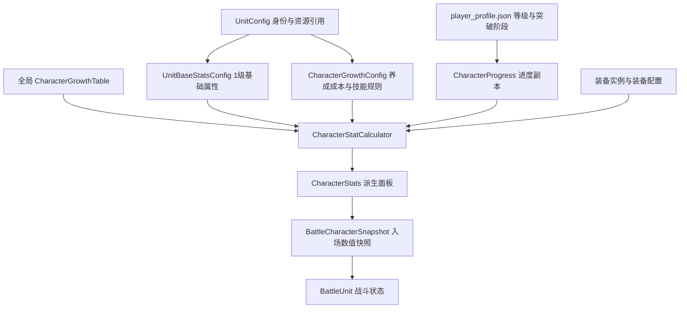

# 角色基础属性与共享成长架构

更新日期：2026-11-27。共享表和角色养成现已支持Excel，详见 [角色成长Excel配置说明](CharacterGrowthExcelGuide.md)。

## 1. 已采用的规则

角色只配置1级生命、攻击、防御和固定基础速度。生命/攻击/防御乘统一的等级与突破系数；速度、暴击率、暴击伤害、元素伤害加成、击破特攻、击破效率不随等级/突破自然增长。

当前采用的端点是本项目确定的成长参数，不宣称是官方源码或官方完整数值表。

| 突破阶段（JSON ascension） | 起始等级 | 等级上限 | 起始系数 | 上限系数 |
| --- | ---: | ---: | ---: | ---: |
| 0 | 1 | 20 | 1.00 | 1.95 |
| 1 | 20 | 30 | 2.35 | 2.85 |
| 2 | 30 | 40 | 3.25 | 3.75 |
| 3 | 40 | 50 | 4.15 | 4.65 |
| 4 | 50 | 60 | 5.05 | 5.55 |
| 5 | 60 | 70 | 5.95 | 6.45 |
| 6 | 70 | 80 | 6.85 | 7.35 |

每个阶段内部使用线性插值：

```text
t = (当前等级 - 阶段起始等级) / (阶段上限 - 阶段起始等级)
系数 = 阶段起始系数 + t × (阶段上限系数 - 阶段起始系数)
角色当前基础三围 = 1级三围 × 系数
```

因此20级未突破（阶段0）为1.95；20级已突破（阶段1）为2.35；25级阶段1为2.60；80级阶段6为7.35。不能只按等级判断是否突破。

三围1级值支持小数。每次从1级原值重新计算，在合并装备/词条后转成现有整数运行时面板，采用 Unity `Mathf.RoundToInt`；不拿上一级已取整结果累加。最终显示和战斗使用整数精度，原始配置精度保留。

## 2. 数据职责与真实流程



- **UnitConfig**：ID、名称、元素、命途、模型、头像、技能与配置引用。已经移除生命、攻击等数值字段。
- **UnitBaseStatsConfig**：独立的静态SO，包含1级三围、基础速度、能量及固定伤害属性。运行时只读。
- **CharacterGrowthTable**：所有角色共用，保存上表端点，检查等级和突破阶段合法性。
- **CharacterGrowthConfig**：保留经验需求、突破材料消耗、技能等级上限、技能倍率成长、升阶及已有天赋规则。不再有角色独立的等级/突破属性增量。
- **CharacterProgress**：实际等级、经验、突破阶段、技能等级、装备实例引用等持久进度。JSON不保存可由配置重新计算的最终面板。
- **CharacterStats / BattleUnit**：运行时对象，计算值和战斗变化不会写回静态SO。

我方正式入场读取 `PlayerRuntime.Characters.GetCharacter(unitId)`，经过计算器和入场快照进入战斗。快照建立之后，修改原进度或基础属性不会改变已经捕获的三围、速度和伤害属性；下次建立快照才使用新数据。

敌人目前经 `BattleDataMaping` 直接读取基础属性，不使用玩家等级表，运行时等级仍为默认1。敌方遭遇等级与敌方成长曲线未在本次扩展。编辑器直接创建测试单位也使用基础值。

## 3. 在哪里配置

### 每名角色的1级基础属性

在 Project 中选择：

- 我方：`Assets/Config/Battle/Units/Allies/Ally_A.asset` 等。
- 敌方：`Assets/Config/Battle/Units/Enemies/Enemy_A.asset` 等。

Inspector上半部分是身份、模型和技能引用；下半部分直接展开“1级生命、1级攻击、1级防御、固定基础速度”等基础属性。新建单位尚未配置时，点击“创建独立基础属性配置”。无需在运行时调整。

基础属性是**独立SO对象、同文件子资源**：在Project中展开单位资产，也能选中 `BaseStats` 单独编辑。每个单位独占，不跨单位共享。这样单位主体与属性一起备份/回滚，避免Excel导入恢复半套数据。不要把其他单位的基础属性拖来共用；导入器会拒绝外部属性资源。

### 全项目共用成长表

选择 `Assets/Resources/Bootstrap/CharacterGrowthTable.asset`，或点击单位Inspector里的“查看共用成长表”。每个Stages元素是一个突破阶段。

程序只使用此Resources路径下的一份表，不通过角色单独指定。更改它会改变所有角色的派生基础三围，但不会改写JSON等级。阶段数量与技能/消耗数组需要保持一致，当前约定7阶段、80级；不建议在配角色时改全局阶段结构。

### 技能等级与突破成本

原 `Assets/Config/Character/Growth_*.asset` 继续存在，原引用保留。

本项目迁移后的技能上限依次是 `2,3,3,4,4,6,7`，突破材料消耗依次是 `2,2,4,4,8,12`。这是从旧五阶段系统扩展得到的项目默认配置，不是星铁技能/材料规则。尽量保留旧20/40/60突破后的技能解锁能力，最终技能上限仍为7；可在各角色的Growth资源内继续配置。光锥等级上限和养成规则未改。

## 4. 装备计算顺序

沿用既有装备和升阶来源处理：

```text
最终ATK = (角色1级ATK × 当前系数 + 光锥当前等级基础ATK)
          × (1 + 已有攻击百分比来源之和)
          + 固定攻击词条
```

生命、防御同理。光锥的白值不乘角色的7.35成长系数。基础速度不自然成长，但已有装备/升阶等明确速度加成仍正常参与计算。

双暴、元素、击破属性当前只完成静态配置、运行时传递和快照。尚未加入它们的装备词条、行迹、Buff修正与实际伤害乘区。

## 5. Excel如何继续使用

- 完整当前配置：`ConfigTables/战斗配置.xlsx`。
- 新空模板：`ConfigTables/战斗配置模板.xlsx`。
- 原 `BattleConfig.xlsx` 保留；旧表仍可导入。

`Units` 仍保留 `maxHealth/attack/defence/speed` 等稳定列名，但生命/攻防现在明确表示1级值，支持小数。导入写入对应独立基础属性子资源。比如攻击填 `53.25`，25级阶段1的角色白值是 `53.25 × 2.6 = 138.45`，合并装备后最终取整。

不需要手动为BaseStats分配Excel ID；它属于对应的unitId。新单位自动获得自己独立的BaseStats。下次导入仍以表格管理字段为准，不做双向自动同步。共用成长表由GrowthStages配置，角色养成由CharacterGrowth及三张子表配置，Units.growthId绑定养成配置。

导入校验会监控基础属性子资源的修改，未保存时阻止应用；写入失败同时恢复单位文件及其中的属性子资源和引用。旧表缺少新增伤害属性列时，继续保留已有值，新增单位用默认值。

## 6. 原资产与旧存档处理

已迁移9个单位和6个角色Growth配置，保留现有1级数值和单位GUID、头像、模型、技能与成长引用。原文件及meta备份在 `ConfigImportBackups/GrowthArchitecture-20261127-211028/`，迁移记录见 `Docs/Verification/SharedGrowthMigration.json`。基础数值没有替换为官方角色数值；高等级战力会因新曲线显著变化，后续需要重新平衡敌人和技能。

档案版本由2升到3。v2读取时在内存中复制档案、转换旧突破索引，等级/经验/装备等保留；本次验证没有保存或重置真实玩家档案。正常后续保存会使用版本3。

旧数据若超过80级、技能等级不兼容或在新封顶节点持有无法保留的经验，拒绝自动转换，保留原档案并明确报错，不静默降级、不删除经验。旧未达到的新突破节点需要按新规则继续突破；不承诺旧100级规则下所有解锁权益无损映射。当前真实存档已单独检查。

## 7. 验证入口和范围

- `Tools > Characters > Verify Shared Growth`：阶段端点、每级增量、同级突破跳变、小数精度、固定属性、快照、旧档转换。
- `Tools > Battle > Verify Offensive Attributes`：属性传递、Excel往返、小数属性、子资源未保存保护与故障回滚。
- 现有 CharacterProgression / BattleConfigImport 验证：升级/突破、装备、保存失败、导入和引用恢复。

结果保存在 `Docs/Verification/SharedGrowthRegression.json`、`CharacterSharedGrowthResults.json`、`BattleOffensiveStatsResults.json`、`SharedGrowthCoreRegression.json`、`SharedGrowthProjectCheck.json`，养成报告另存 `CharacterSharedGrowthProgression.txt`。

完整BattleAction验证仍被既有 `ActionTimelineResourceChecks` 阻断：它查找旧 `energy_bar`，当前UI为 `energy_show`，引发空引用。没有为了让验证通过修改用户UI；后续战斗服务、资源、AI、结算、多波和持久化检查单独执行。编辑器验证不等于完整Play Mode演出验收。


### 本次实际验证结果

| 检查 | 结果 |
| --- | --- |
| Unity编译 | 通过，无编译错误 |
| 共享成长专项 | 104项通过 |
| 伤害属性/小数Excel/子资源回滚 | 54项通过 |
| 角色养成回归 | 361项通过 |
| Excel导入回归 | 99项通过 |
| 完整BattleAction | 154项通过后被既有能量UI字段检查中断 |
| 后续战斗逻辑独立补跑 | 29项通过 |
| 9个实际单位重新导入磁盘 | GUID、身份、模型、头像、技能和成长引用一致，基础属性子资源有效 |
| 新Excel原样预览 | 有效，0项更新 |
| 原BattleConfig.xlsx预览 | 有效，0项更新 |
| 当前真实玩家档案 | 6名角色读取成功，派生属性和战斗快照一致，文件哈希未变 |

真实档案例子：岩壁守卫6级、阶段0，成长系数1.25，生命188、攻击62、防御40、速度95；霜星术师20级、阶段0，系数1.95，生命351、攻击107、防御39、速度102。两者暴击率5%、暴击伤害50%。当前整数面板采用Mathf.RoundToInt，恰好0.5时使用其偶数舍入规则。
