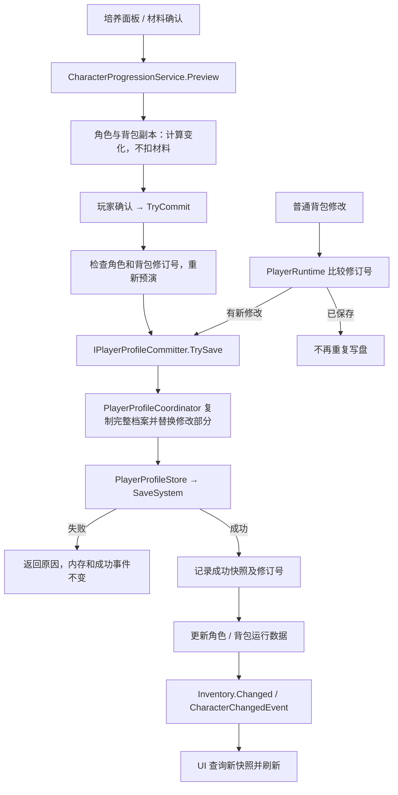

# 玩家档案：从养成操作到保存

项目只有一个局外玩家运行时 `PlayerRuntime`。它创建背包服务、养成服务和档案协调器；场景切换不会重新创建这些数据。配置资产描述规则，玩家档案记录进度，场景暂停记录只服务本次往返。

| 模块 | 负责什么 | 为什么保留这一层 |
| --- | --- | --- |
| PlayerRuntime | 启动读取、服务持有、普通背包自动保存、暂停和退出保存 | 数据生命周期不依赖 UI 或探索场景 |
| InventoryManager | 绑定运行时背包，转发使用 / 装备 / 养成意图 | 兼容现有 UI，不再拥有第二套数据和文件 |
| InventoryService | 材料、装备实例、锁定与穿戴保护、背包修订号 | 背包规则可独立验证 |
| CharacterProgressionService | 预览、消耗、校验、属性、提交后的运行数据和事件 | 养成规则不进入 UI 或存储层 |
| PlayerProfileCoordinator | 深拷贝、完整候选档案、成功保存修订号 | 防止多个业务分别拼装档案而遗漏字段 |
| PlayerProfileStore | 现有 SaveSystem 的薄适配 | 文件格式和备份机制保持兼容 |
| PlayerProfileFactory | 无完整档案时生成初始角色和物品 | 初始数据与旧档迁移脱钩 |



## 养成提交接口

```csharp
bool TrySave(CharacterRosterData roster, InventoryData inventory,
    long inventoryRevision, out string reason);
```

养成每次成功提交增加一次角色修订号，并通过 `Inventory.PublishCommitted()` 增加一次背包修订号。提交前给协调器的是这次发布后的背包修订号。这样通知触发后，PlayerRuntime 知道这份数据已写盘；后续真实修改仍会使修订号不一致并触发保存。

预览过期、材料不足、装备已锁定或已穿戴时，由业务服务拒绝。磁盘保存失败时协调器不前移保存版本，服务不应用候选数据，因此可以重新预览、提交。普通背包修改已经在内存生效，写盘失败保留未保存状态，每 5 秒重试；不要把它误认为养成的“先保存再应用”。

复制规则集中在 `PlayerProfileData.Copy()`，它调用角色与背包 DTO 的深拷贝。协调器持有自己的完整快照，存储接口也收到独立副本。以后加入活动进度，需要同时扩展档案字段、Copy 和协调器提交入口；业务服务仍只负责自己的规则。当前没有为尚未实现的活动建立抽象。

## 启动与兼容

1. `PlayerRuntime` 在场景加载前自动创建并常驻。
2. 从 `Resources/Bootstrap/PlayerRuntimeConfig` 取得角色目录、物品目录和存档槽。
3. 读取 `player_profile.json`；不存在才调用 Factory，不读取旧的 `player_inventory.json`。
4. 验证背包和角色数据，创建服务。新档验证通过后写入一次。
5. 主文件损坏但备份可用时只读运行；两份均无效时禁止初始化和覆盖。

现有完整档案的名称、字段和格式版本 1 不变；存储底层与成组备份未重建。旧背包文件和其他模块文件不会被删除。

`InventoryManager.SaveInventory()` 只是兼容门面，实际转给 `PlayerRuntime.Save()`，不存在独立加载、独立存档槽或第二个自动保存循环。编辑器背包搭建工具使用统一 PlayerRuntimeConfig，不再生成旧模式参数。

## 调试与演示

- 普通背包：添加物品或切换装备锁定，观察自动保存，重新启动确认读取。
- 养成：Preview → 真实确认按钮 → 数量与角色属性一起刷新；返回探索保留修改。
- 场景往返只恢复临时呈现和运动状态，不回滚玩家档案。
- `Tools/Characters` 的现有逻辑验证包含模拟保存失败、过期预览、重复保存和成组备份测试；场景回归用隔离测试槽。执行结果见 `ArchitectureVerification.md`。

这套设计只解决当前的同步本地保存。没有通用事务框架、联网协议或多版本并发系统。
