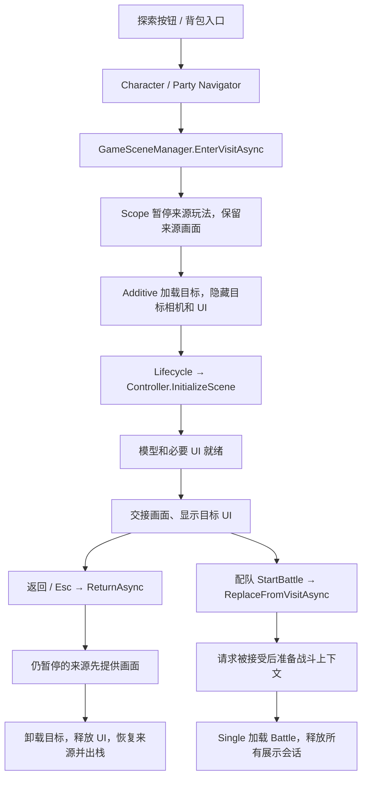

# 统一场景流程：使用与职责

## 现在的入口

运行 `SampleScene`，探索 HUD 的角色按钮走 `CharacterSceneNavigator`，配队按钮走 `PartySceneNavigator`。两者由 `GameSceneManager` 追加加载，探索场景和玩家对象一直保留。返回按钮或 Esc 会卸载最上层展示场景，恢复来源。

配队子弹窗先处理 Esc；子弹窗关闭后，再按 Esc 返回探索。配队完成后点击开始挑战，会整场进入战斗，结束所有展示会话。战斗结算的重新配队、重试和退出由常驻管理器执行，协程不会随旧场景销毁而中断。

| 操作 | 行为 |
| --- | --- |
| Sample → Character → 返回 | Additive；恢复原 Sample、原玩家和原 UI |
| Sample → Party → 返回 | Additive；恢复原 Sample、原玩家和原 UI |
| Sample → Party → Character → 返回两次 | 按栈逐层返回；Party 返回前 Sample 继续暂停 |
| Party → Battle | Single；销毁探索和展示场景，释放会话持有的时间与输入限制 |
| 战斗结算 → 重新配队 | Single 到 Party；保留原关卡与队伍快照 |
| 重配 → 返回 | 重新加载退出目标，清除这次战斗上下文 |
| 战斗结算 → 退出 | 重新加载退出目标；不恢复战前临时运动状态 |
| 编辑器直接运行 Character / Party | 自动接管为无来源会话；返回 Sample |

## 代码位置与调用关系

| 文件 | 职责 |
| --- | --- |
| `Assets/Scripts/Common/Scene/GameSceneManager.cs` | 常驻实例、异步场景操作、互斥、会话栈、流程顺序与失败清理 |
| `Assets/Scripts/Common/Scene/SceneFlowTypes.cs` | 操作结果、只读会话句柄、加载参数、业务生命周期接口 |
| `Assets/Scripts/Common/Scene/ScenePresentationLifecycle.cs` | 按目标展示层连接暂停策略与场景入口 |
| `Assets/Scripts/Common/Scene/ScenePresentationScope.cs` | 来源玩法、动画、输入、UI 与时间的记录和恢复 |
| `Assets/Scripts/Common/Scene/ScenePresentationVisibility.cs` | 相机、灯光和监听器的画面交接 |
| `Assets/Scripts/UI/Framework/SceneTransitionPanel.cs` | UIManager 管理的 Overlay；场景管理器驱动淡入淡出，结束时统一释放遮罩和输入 |
| `Assets/Scripts/GamePlay/Character/Progression/Common/CharacterSceneNavigator.cs` | 角色业务入口，校验数据与 UI，传角色、页签、装备上下文 |
| `Assets/Scripts/UI/BattleParty/PartySceneNavigator.cs` | 探索配队入口、配队返回与重配取消 |
| `Assets/Scripts/UI/BattleParty/PartySceneController.cs` | 配队展示、模型和业务上下文；开始战斗 |
| `Assets/Scripts/GamePlay/Battle/InBattle/Common/BattleSessionController.cs` | 结算后重试、重配、退出；观察最终操作结果 |



角色养成示例调用链：

```text
CharacterEntryButton / 背包中的角色导航请求
  → CharacterSceneNavigator.TryEnter(角色、页签、装备)
  → GameSceneManager.EnterVisitAsync
  → ScenePresentationLifecycle.SuspendSource
  → Unity Additive 异步加载 Character
  → CharacterSceneController.InitializeScene
  → UIManager.Open(CharacterDetail, context, ownerSceneHandle)
  → 等待面板 State == Open
  → 确认目标屏幕相机可用，同一帧交接来源与目标的相机 / 灯光 / 监听器
  → 操作成功，玩家可以操作养成 UI

返回按钮 / Esc
  → CharacterSceneNavigator.Return
  → GameSceneManager.ReturnAsync(栈顶句柄)
  → 挂起目标交互；切活动场景；恢复来源显示并隐藏目标显示
  → 保持来源玩法暂停，等待目标卸载
  → 释放目标 UI；恢复来源 UI / 输入 / 相机 / 时间
  → 会话出栈，操作成功
```

升级、装备和材料扣除仍由 `CharacterProgressionService` / `InventoryService` 负责；编队仍由 `BattlePartyManager` / `PartyFormationState` 负责。管理器不保存或回滚整份玩家数据。

## 普通业务代码怎样调用

```csharp
using Game.Characters;

// 探索中打开养成，保留探索。
CharacterSceneNavigator.TryEnter(unitId, CharacterTab.Attributes);

// 探索中打开配队，保留探索。
PartySceneNavigator.TryEnter();

// 普通整场切换。不能绕过一个正在展示的会话。
var operation = GameSceneManager.Instance.LoadAsync(
    SceneId.Sample,
    new SceneLoadOptions { Transition = SceneTransitionMode.Fade });

operation.OnCompleted(result =>
{
    if (!result.Succeeded)
        UnityEngine.Debug.LogError(result.Error);
});
```

`TryEnter` / 兼容接口 `TryLoad` 返回 true 仅代表请求被接受，不代表加载完成。要处理最终成功或失败，使用 `SceneOperation`：

```csharp
var operation = GameSceneManager.Instance.LoadAsync(SceneId.Battle);
yield return operation;
if (!operation.Succeeded)
{
    // operation.Error 包含失败原因及实际驻留场景。
    yield break;
}
var loadedScene = operation.Scene;
```

如果调用者会被 Single 切换卸载，不要把关键结果处理放在调用者自己的协程后半段。使用 `OnCompleted`，并对已销毁的 Unity 对象做空值判断；实际加载由管理器上的常驻协程持有。

`SceneOperation` 提供 `Accepted`、`IsDone`、`Succeeded`、`Stage`、`Progress`、`Error`、`Scene` 和 `Visit`。完成后再注册 `OnCompleted` 也会收到结果。句柄非空只代表它曾被创建，是否仍是有效会话由管理器校验；不要缓存已返回的句柄再次操作。

## 新增一个需要往返的展示场景

先登记 SceneId、SceneCatalog 和构建列表；为模型分配独立展示层，让目标相机 / 灯光只照该层。UIConfig 和 prefab 按 UILayer 分类，保留原有空间与布局。

控制器的最小形态如下。`panelId` 和 `previewMask` 在 Inspector 指向该场景的真实配置；业务初始化放在 Open 之前，模型 Animator 使用 UnscaledTime。

```csharp
public sealed class ExamplePresentationController : MonoBehaviour, ISceneEntryPoint
{
    [SerializeField] private UIId panelId;
    [SerializeField] private LayerMask previewMask;
    private SceneVisitHandle visit;
    public ISceneVisitLifecycle VisitLifecycle =>
        new ScenePresentationLifecycle<ExamplePresentationController>(previewMask.value);

    private void Start()
    {
        var scenes = GameSceneManager.Instance;
        if (!scenes.IsScenePending(gameObject.scene))
            scenes.AdoptDirectScene(gameObject.scene, VisitLifecycle);
    }

    public IEnumerator InitializeScene(SceneVisitHandle handle, object context)
    {
        visit = handle;
        // 在这里创建展示模型、订阅本场景业务事件。
        var ui = UIManager.Instance;
        var panel = ui.Open(panelId, context as IUIContext,
            ownerSceneHandle: gameObject.scene.handle);
        yield return ScenePresentationLifecycle<ExamplePresentationController>.WaitForPanel(ui, panel);
    }

    public void Return() => GameSceneManager.Instance.ReturnAsync(visit);
    // OnDisable / OnDestroy 解除自己订阅的业务事件。
}
```

导航入口只做业务校验并提交请求。以已实现的养成为例：

```csharp
var operation = GameSceneManager.Instance.EnterVisitAsync(
    SceneId.Character,
    new ScenePresentationLifecycle<CharacterSceneController>(CharacterSceneNavigator.PreviewMask),
    new CharacterSceneContext(unitId, CharacterTab.LightCone, equipmentId));
operation.OnCompleted(result =>
{
    if (!result.Succeeded)
        Debug.LogError(result.Error);
});
```

不要再增加一个常驻 Navigator，也不要在 Controller 中自行加载或卸载场景。面板从 Context 获取业务控制器，不由场景入口持有 UIManager 创建的面板实例。

`ISceneVisitLifecycle` 的四个职责：

1. `SuspendSource` 返回暂停凭据；该方法在淡出前执行，防止玩家在等待期间切换运动状态。
2. `InitializeTarget` 初始化目标并等待必要 UI 就绪；异常进入统一清理路径。
3. `SuspendTarget` 暂时阻止返回过程中的目标交互；卸载失败时释放凭据以恢复目标。
4. `ReleaseTarget` 释放明确属于目标场景的 UI 与业务资源，应可重复调用。

暂停凭据的 `Resume` 恢复来源；`Discard` 在 Single 替换时仅释放所有权与全局状态，不重新启用已经退出的场景对象。

共享暂停凭据还实现 `IScenePresentationSuspension`：`ShowPresentation` / `HidePresentation` 只交接相机、灯光和监听器，不解除玩法暂停、输入限制或 UI 挂起。进入时保留来源显示，目标在 `sceneLoaded` 阶段暂缓显示，直到控制器与必要 UI 初始化完成后才交接；返回时先恢复来源显示，再异步卸载目标，避免切换空档出现 `No cameras rendering`。目标没有可用屏幕相机时按初始化失败清理，不关闭来源显示。

## 配队进入战斗：上下文准备时机

```csharp
var options = new SceneLoadOptions
{
    Prepare = () =>
    {
        // 阵容先完成业务校验；请求被接受后，实际加载前写入上下文。
        BattleLaunchContext.Set(data);
        BattleSessionContext.Begin(data, targetScene, exitScene);
    },
    Rollback = () =>
    {
        // 恢复调用前保存的业务上下文；项目内部已有完整实现。
    }
};
var operation = GameSceneManager.Instance.ReplaceFromVisitAsync(
    visitHandle, targetScene, options);
```

`Prepare` 不会在被拒绝的请求上执行。准备抛异常或新场景尚未激活时加载失败，会执行 `Rollback`。新场景已经激活后，不声称能还原已销毁的旧场景。项目中的开始挑战、战后重试与退出均已保存旧上下文供失败恢复。

## 低层场景操作

- `LoadAsync(id, options)`：异步 Single / Additive；`Immediate` 仅表示没有淡入淡出，不是同步加载。
- `UnloadAsync(scene)`：按实际场景实例卸载并验证，不能卸载最后一个场景。
- `TryGetLoadedScene(id, out scene)`：只读查询。
- `TrySetActiveScene(scene, out error)`：验证后切换活动场景；对当前活动场景重复调用成功。
- `EnterVisitAsync` / `ReturnAsync` / `ReplaceFromVisitAsync`：管理往返业务和暂停所有权。

普通 Additive 加载是低层资源操作，不隐式创建暂停会话，也不调用展示控制器的 `InitializeScene`。需要玩家能进入并返回的展示界面，应使用 `EnterVisitAsync`。Single 加载到实现展示入口的场景会接管为独立会话，以支持独立运行时的返回按钮。

```csharp
var additive = GameSceneManager.Instance.LoadAsync(SceneId.Party,
    new SceneLoadOptions
    {
        LoadMode = UnityEngine.SceneManagement.LoadSceneMode.Additive,
        SetActive = false
    });
yield return additive;
if (additive.Succeeded)
    yield return GameSceneManager.Instance.UnloadAsync(additive.Scene);
```

有会话时不要用低层操作绕过它；并发请求直接拒绝，不排队。正在加载与正在展示分别由 `IsLoading` 和 `VisitCount` / `CurrentVisit` 表示。

## 暂停与呈现细节

- 暂停只捕获来源场景中的玩家、相机、监听器、灯光、Animator 与输入动作；常驻 UI 通过 UIManager 的呈现凭据管理。
- `PlayerController.IsScenePaused` 独立于普通“禁止移动”；暂停期间不运行状态机或物理控制，不主动切 Idle 或清零速度。
- 保存原时间比例、组件启用值、相机遮罩和实际启用的 InputAction，返回还原记录值。
- 来源 UI 同时使用已有面板快照 `SuspendPresentation` 和覆盖后续面板的 `SuspendScenePresentation(source.handle)`，保留实例、打开状态和上下文；恢复 UI 的限制后再移除场景暂停限制。相机关闭与玩法暂停分阶段执行，来源画面保留到目标初始化完成。
- 输入过渡锁由 UIManager 汇总；光标也仍由 UIManager 管理。
- 展示模型使用非缩放时间。嵌套进入下一展示场景时，来源展示 Animator 也会暂停。
- CharacterPreview 使用 Layer 8；PartyPreview 使用 Layer 9。Party 环境和运行时模型使用 Layer 9，Party 相机只看 Layer 9 和 UI；来源相机和灯光在加载前就排除本次目标层，但保持来源画面；目标 UI 初始化时隐藏。目标就绪后交接画面，返回卸载完成后恢复原 Mask。嵌套进入只排除下一目标的层，保留来源自己的展示层。
- PartyBackdrop 仍是原 World Space UI，未改变其 Canvas 空间、世界位置和缩放。
- `Time.timeScale = 0` 不代表所有自定义脚本都停止调用。未来新增使用非缩放时间的 NPC / 计时器时，在更新前检查 `GameSceneManager.Instance.IsSceneSuspended(gameObject.scene)`，或在业务生命周期中提供专门暂停逻辑。

## 失败后的状态

| 情况 | 处理 |
| --- | --- |
| 无效场景、并发请求、重复目标、非栈顶或过期句柄 | 立即返回失败结果，业务准备不执行 |
| 新展示场景初始化失败 | 卸载本次创建的目标；成功清理后恢复来源 |
| 返回时卸载被拒绝且目标仍在 | 保留会话与来源暂停，恢复目标交互，允许再次返回 |
| 初始化失败且目标无法清理 | 保留残留场景与会话；拒绝继续叠加；通过 `ReturnAsync(CurrentVisit)` 再次清理 |
| 清理完成但来源恢复仍出错 | 保留错误记录，不宣告成功；错误从 SceneOperation 返回 |
| Single 已激活后初始化失败 | 说明旧场景无法回滚；可调用普通 `ReturnToSampleAsync()` 返回 Sample |

不创建专用恢复 UI、不排队、不自动重试。错误由调用方从 SceneOperation 读取并写入现有日志。错误信息包含实际驻留场景，`Succeeded` 只在流程完成后为 true。编辑器回归中的卸载拒绝通过仅 Editor 编译的故障注入字段产生，正式玩家构建不包含该字段。

## 配置与回归入口

资源已经配置。以后重建相关 UI 时，可运行 `Tools → Scenes → Configure Unified Scene Flow`：安装探索配队入口与配队返回按钮，设置 PartyPreview，修正场景构建 GUID，并校验 SceneCatalog。工具不会保存当前有未保存改动的 Sample；如果 PartyScreen 本身有未保存修改，则拒绝覆盖。

自动回归菜单：

- `Tools → Scenes → Verify Unified Scene Flow`：在 Sample 中运行完整往返、数据保留、异常和战斗链路。
- `Tools → Scenes → Verify Direct Character Startup`。
- `Tools → Scenes → Verify Direct Party Startup`。
- `Tools → Scenes → Verify Direct Battle Startup`。

回归使用临时存档槽，结束后恢复原 PlayerRuntimeConfig 的原始文件字节与 Play Mode 启动场景设置，删除测试存档槽。不会覆盖玩家现有进度，也不保存编辑器中未保存的探索场景。

新回归结果位于 `Temp/SceneFlow/results.json`、`direct-Character.json`、`direct-Party.json`、`direct-Battle.json`；`restored.txt` 记录隔离配置已恢复。本轮整理结果保存为 `Docs/ArchitectureVerification/`；原来的 `SceneFlowChecks.json` 是历史结果。实际执行范围与测试边界见 `Docs/SceneFlowVerification.md`。

本次没有加入认证、网络、Lua 改造、AB 场景加载、跨进程探索存档或新的异步库。
