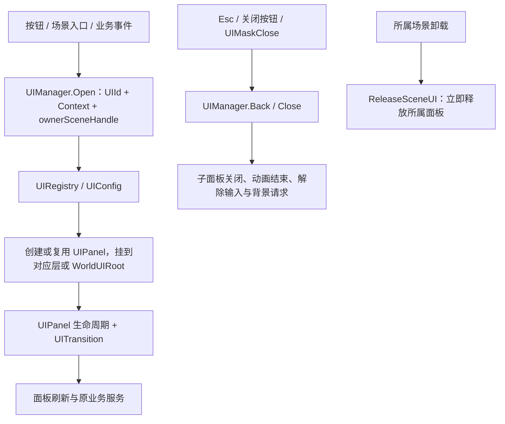

# UIManager 接入说明

本次覆盖项目现有的探索、背包、设置、对话、养成、配队、战斗和场景切换 UI。活动/签到草稿不在本次范围内。保留已有 UIManager 功能，不改变养成、配队和战斗的业务规则。

## 已登记的面板

当前 UIRegistry 登记 17 项，配置与预制体均按 UILayer 分类。

| 系统 | UIId | 入口与数据来源 |
| --- | --- | --- |
| 探索 | ExplorationHUD | SceneUIPresenter 按场景打开 |
| 设置 | Settings | HUD 的 UIOpenButton；SettingsPanel 通过 Owner.Close 关闭 |
| 背包 | Backpack | PlayerInputHandler 的 B 键；InventoryUIController 绑定 InventoryService |
| 对话 | Dialogue、DialogueInteractions | DialogueUIPresenter 转发 DialogueRunner 事件与 Context，明确传入所属场景句柄 |
| 养成 | CharacterDetail | CharacterSceneNavigator → 场景管理器 → CharacterSceneController.InitializeScene → UIManager.Open |
| 养成弹窗 | CharacterMaterials、CharacterEquipment、CharacterConfirm | CharacterPanel 打开子面板并传入父句柄与业务 Context |
| 配队 | BattleParty、PartyBackdrop | PartySceneController 打开配队主界面；SceneUIPresenter 打开 World Space 背景 |
| 选人 | AlliesChoose | BattlePartyCanvasUI 以自身句柄为 parent 打开 |
| 战斗 | BattleAlliesStatus、BattleEnemiesStatus、BattleCommands | BattleManager 传入真实单位、相机及战斗 Context |
| 结算 | BattleResult | BattleSessionController 打开结算面板，业务回调负责重配、重试和退出 |
| 切换 | SceneTransition | GameSceneManager 打开全局 Overlay 并驱动 FadeTo |

UIId 中尚未登记的预留项不是已实现界面。本次没有为它们制作空面板，也没有增加活动界面的登记。

## 框架接管了什么

| 位置 | 方法 | 现在的职责 |
| --- | --- | --- |
| UIManager | Open、ProcessInstance | 创建/复用、更新 Context、执行打开关闭流程，打开期间更新的数据在完成后同步 |
| UIManager | RefreshFrameworkState、RefreshCoveredState、Back | 按 layer 与同层打开顺序决定覆盖和返回；不能越过不可返回的模态层关闭下面的窗口 |
| UIPanel | SetCovered、RefreshPresentation | hideLowerWindows 真正隐藏下层 Window/Popup，并与场景挂起共同生效；独立的展示 CanvasGroup 不争抢动画 alpha |
| UIMaskClose / UIPanel | OnPointerClick → HandleMaskClick | 读取 closeWhenClickMask，再交给 Owner.Close；配队不再自行绑定背景按钮关闭逻辑 |
| UIFadeTransition | PlayOpen、PlayClose、Stop | 10 个现有 Window/Popup 使用统一淡入淡出，默认 0.2 秒，使用非缩放时间 |
| UIHUDEntryVisibility | Refresh、CanActivate | 统一角色、配队、设置入口的显隐、交互和射线；判断来自 IsUnobstructedHUD |
| UIManager | SuspendPresentation、SuspendScenePresentation | 保留原窗口实例和 Context；按场景挂起也覆盖随后创建的该场景面板 |
| UIManager | Release、ReleaseSceneUI | 同步终止动画、关闭子面板、清理请求并销毁实例；用于场景/系统清理，不作为普通关闭按钮的默认调用 |
| UIPanel | OpenRoutine、CloseRoutine | 动画等待后确认面板仍处于对应状态，防止卸载后继续操作已释放对象 |

屏幕面板取消独立 Canvas 的 overrideSorting，层级统一跟随 UIRoot。PartyBackdrop 仍在 WorldUIRoot 下，保留原 Canvas 模式、位置、尺寸和缩放。

## 场景切换遮罩

GameSceneManager 不再自行创建 Canvas 和遮罩。它通过 `UIManager.Open(UIId.SceneTransition)` 获得 `SceneTransitionPanel`，控制其 `FadeTo`，完成时调用 `UIManager.Release`。

遮罩配置位于 `Assets/Config/UI/Overlay/SceneTransitionUIConfig.asset`：Global、Overlay、modal，不接受 Esc；`suspendWithPresentation=false`，所以来源场景 UI 挂起不会隐藏切换遮罩。其它业务面板保持默认 true。

淡入淡出改变 Image 透明度，不改变负责交互的 CanvasGroup 透明度，因此透明切换期间仍可拦截点击。无视觉过渡的 Immediate 操作也会临时使用透明 Overlay。结束时同帧释放遮罩、切换输入请求并完成 SceneOperation，避免玩家恢复更新时仍被残余遮罩限制输入。

## 后续怎么写 UI

1. 面板根组件继承 UIPanel，在 OnOpen/OnContextChanged 绑定业务数据，在 OnClosed 解除业务订阅。业务运算留在原服务中。
2. UIConfig 与面板 prefab 放在各自匹配的 UILayer 目录，并把配置加入 UIRegistry。
3. 场景入口调用 `UIManager.Instance.Open(id, context, ownerSceneHandle: gameObject.scene.handle)`。子弹窗调用 `Owner.Open(id, context, parent: Handle)`；框架继承父面板的场景归属。
4. 普通关闭使用 `Owner.Close(Handle)`。关闭是异步动画流程；需要等待时查询面板 State，不能假设调用后下一行已经关闭。
5. 想要背景点击关闭：背景 Graphic 保持 Raycast Target，挂 UIMaskClose，配置 closeWhenClickMask。正文区域应有可接收射线的 Graphic，避免点正文落到背景。
6. 想要窗口淡入淡出：根节点挂 UIFadeTransition，调整 duration/ease。不要让业务脚本另写同一套开关动画。
7. 只打开普通 UI 的按钮可挂 UIOpenButton、设置 UIId，再将 Button.onClick 绑定 Open。养成/配队按钮仍先调用 Navigator 加载展示场景，由目标控制器打开 UI。

现有资源已接好，可以直接运行 SampleScene。`Tools/UI/Apply Framework Integration` 用于重新应用现有登记面板的接线；它会保存配置和预制体，通常无需每次运行。养成、背包和场景生成工具也同步接入了公共配置方法。

## 哪些内容继续由面板或业务管理

- 物品格子、角色卡片、对话选项、单个血条是面板内部控件，由所属面板创建和回收。BattleEnemyBar 已连同原 meta 移入 Widgets/Battle，引用 GUID 不变。
- 展示角色模型、相机和场景暂停由场景系统管理；UIManager 管理这些场景中的界面。
- UIBlurManager 是模糊渲染服务；UIBackgroundController 汇总请求，UIBlurMask 显示结果，不把它们登记成窗口。
- 设置面板当前仍是现有演示面板。本次接通设置按钮与框架开关，没有新增音量/画质设置业务。

## 验证记录

验证工具：`Assets/Editor/UIIntegrationVerification.cs`，集成在 `Tools/Scenes/Verify Unified Scene Flow`。回归使用隔离存档槽，结束后恢复原配置，不保存或重新打开用户的编辑场景。

2026-11-09 使用 Unity 6000.3.23f1 实际完成 Unity 脚本编译，编译错误为 0；主回归 **226 项通过**，回归运行期间捕获的未处理异常为 0；Character、Party、Battle 独立启动各 **4 项通过**。

实际执行结果与资源核对见 `UIIntegrationVerification/`。覆盖真实 HUD 设置按钮、层级返回、隐藏/挂起叠加、父子关闭、缓存重开、暂停下动画、透明 Overlay 射线、动画中释放、子面板场景归属、配队遮罩开关、探索往返与战斗链路。独立启动验证覆盖 Character、Party、Battle 返回 Sample。17 项登记资源引用有效，10 个 Window/Popup 均有框架动画，World Space 背景与移动条目的 GUID 保持。

运行环境仍有原有提示：本地首包 AssetBundle 未构建。本轮 UI 验证走当前项目的本地启动流程，没有验证 AB 更新链路。配队当前胶囊展示 prefab 没有 Animator，测试采用内存动画探针检查暂停策略，并未给原 prefab 添加角色动画。

这些是 Editor Play Mode 自动验证和资源/源码检查，不代表已完成独立 EXE、全部分辨率或所有视觉布局的人工验收。
